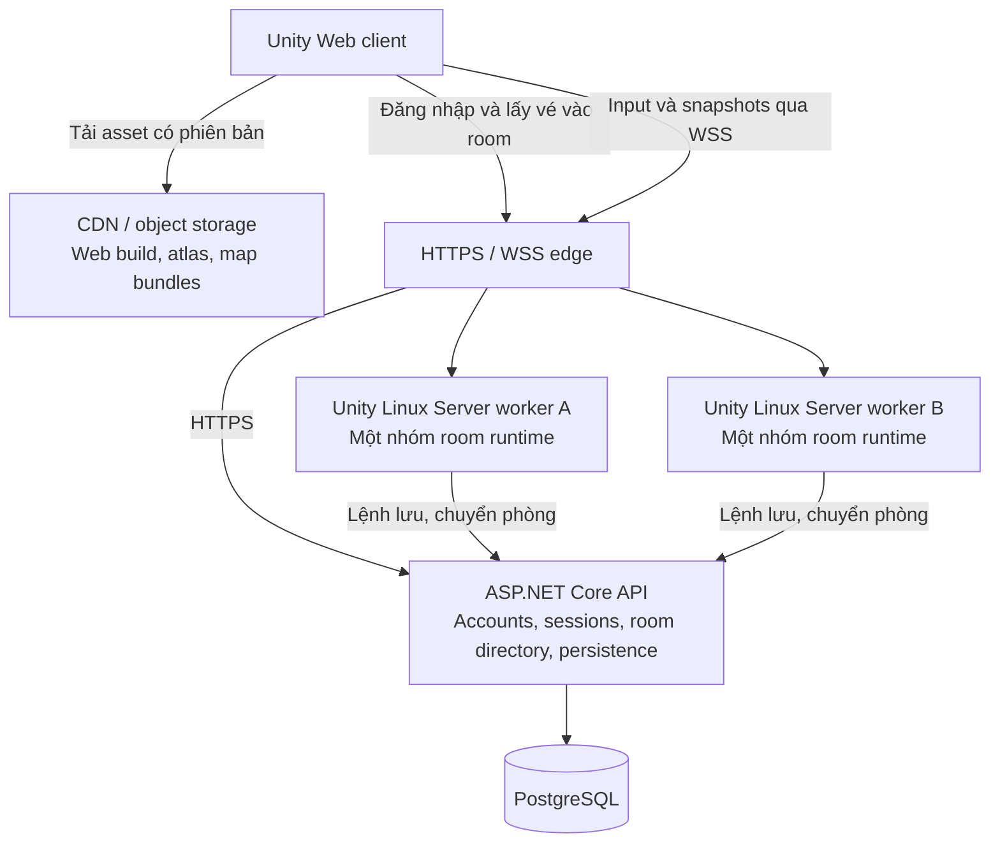

> Lịch sử trước 12/10/2026. Bản hiện hành chỉ thử mỹ thuật; gameplay đã được chuyển ra khỏi source đang dùng. Xem [kiến trúc hiện hành](CODE_ARCHITECTURE.md).

# Linh Thú Ký — Kiến trúc online theo vùng

**Hướng hiện hành: MMORPG tự do khám phá, combat người chơi; xem cập nhật 07/10 và WORLD_FOUNDATION ở cuối tài liệu.**

Ngày: 05/10/2026. Trạng thái: thiết kế đề xuất; chưa triển khai hoặc đo sức chứa server. Người dùng đã xác nhận **100–300 người đồng thời trên toàn thế giới, mỗi phòng có giới hạn riêng**. Mẫu mỹ thuật hiện hành nằm trên nhánh `codex/living-garden-v7`, mốc `5ec5fcf`.

## 1. Mục tiêu và phạm vi

Thiết kế một thế giới 2D gồm 20–30 vùng lớn nối bằng cổng. Mốc phát hành đầu là 100 người hoạt động đồng thời; kiến trúc cho phép phân bổ vùng sang thêm worker/máy để thử và nâng lên 300. Chỉ tăng admission cap sau khi vượt bài đo tải tương ứng. 300 kết nối đứng yên không chứng minh được 300 người chơi giao tranh.

Gameplay hiện hành được ghi trong [đặc tả gameplay](GAMEPLAY_SPEC.md): gắn bó và bồi dưỡng linh thú, khám phá lấy nguyên liệu, chuyển điều khiển giữa nhân vật và thú, Thần Đình có trữ vật và trồng trọt. Tiến trình từ một tới tối đa ba linh thú theo cảnh giới còn cần làm rõ giới hạn khế ước/ra trận. Giao dịch tài nguyên và các nghề là hướng sản phẩm; luật cụ thể và thứ tự triển khai chưa chốt. Các bài tải phía dưới vẫn dùng kịch bản cao nhất ba thú mỗi người. PvP đông người và chiến đấu xuyên cổng cần đặc tả riêng. Mỹ thuật do `ArtDirection/STYLE_GUIDE.md` sở hữu.

“Rộng gấp 20–50 lần” được hiểu tạm là **diện tích**, chưa phải mỗi chiều. Nếu tăng diện tích 20–50 lần thì chiều dài/rộng tăng khoảng 4,5–7,1 lần khi giữ tỷ lệ cạnh. Chưa đo kích thước phòng Soul Knight nên không gán số tile của game đó. Mẫu thử phòng 128×128 đến 192×192 tile là đề xuất để đo cảm giác di chuyển; cần đối chiếu tỷ lệ sau khi chọn phòng tham chiếu cụ thể.

Map rộng không tự làm gameplay hay hơn: mỗi vùng cần đường đi, điểm thu thập, cụm giao tranh và khoảng nghỉ. Làm hai vùng đủ nội dung trước khi nhân lên 20–30.

## 2. Trạng thái dự án đã kiểm tra

- Unity 6000.6.4f1; sample dùng Built-in renderer, Pixel Perfect Camera và New Input System.
- `Assets/ArtSample/Scripts` hiện có `SpiritTurtleController` và `LivingGarden`; chưa có gameplay online, networking package, backend hoặc database.
- Kế hoạch v2 mô tả URP/Cinemachine, EventBus toàn cục và SaveService JSON, nhưng package manifest chưa có URP/Cinemachine. Không coi tài liệu cũ là bằng chứng những thành phần này đã được triển khai.
- Mẫu art chạy được trong Editor/WebGL là bằng chứng mỹ thuật và điều khiển cục bộ; không chứng minh tải multiplayer.

## 3. Sơ đồ triển khai



API là một ứng dụng có module rõ ràng. Realtime worker tách tiến trình vì có vòng mô phỏng và yêu cầu CPU khác API; đây không phải lý do để tách mỗi feature thành một dịch vụ mạng. Có thể chạy API, PostgreSQL và 1–2 worker trên một host khi thử beta, với giới hạn tài nguyên và backup ngoài máy; một host vẫn là một điểm lỗi chung.

Unity Dedicated Server loại nhiều thành phần chỉ phục vụ hình ảnh/âm thanh; server chỉ giữ mô phỏng và dữ liệu cần thiết. Đồ họa được render trên máy người chơi, không stream video từ VPS. [Unity Dedicated Server](https://docs.unity3d.com/6000.0/Documentation/Manual/dedicated-server-optimizations.html).

## 4. Bộ công nghệ đề xuất

| Phần | Lựa chọn | Điều kiện trước khi khóa phiên bản |
| --- | --- | --- |
| Client | Unity 2D, Tilemap, Sprite Atlas, Pixel Perfect; WebGL2 là baseline của prototype | Chơi đúng trên các trình duyệt mục tiêu; render API không quyết định số người online |
| Game server | Cùng Unity project, build Linux Dedicated Server; C# rules dùng chung | Kiểm tra build Linux, strip presentation và cô lập Physics2D giữa hai room |
| Networking | FishNet + Bayou qua WSS | Spike prediction, reconnect, chuyển scene, tải thật bằng Web build trên Unity hiện có; pin tag/commit và kiểm license trước import |
| Nội dung tải dần | Unity Addressables, bundle theo biome/room/chunk | Thử bridge tải scene với FishNet; không giả định chỉ bật một checkbox là xong |
| API | ASP.NET Core trên .NET LTS còn hỗ trợ ở thời điểm triển khai | DTO có version; không bắt Unity client dùng cùng runtime .NET của API |
| Dữ liệu bền vững | PostgreSQL, migration và backup được kiểm tra phục hồi | Giao dịch atomic, idempotency và kiểm thử crash/retry |
| Vận hành ban đầu | Linux, container hoặc systemd, reverse proxy TLS, metrics và log có giới hạn | Tài nguyên mỗi worker có trần; DB chỉ truy cập qua mạng riêng |

FishNet có prediction để client phản hồi chuyển động ngay trong khi server giữ quyền quyết định; Bayou hỗ trợ Web và WSS. Observer system giới hạn các đối tượng mỗi client được nhận. Đây là căn cứ chọn làm ứng viên, **không phải chứng nhận chạy được 300 người cho game này**. [Prediction](https://fish-networking.gitbook.io/docs/guides/features/prediction/what-is-client-side-prediction), [Bayou](https://fish-networking.gitbook.io/docs/fishnet-building-blocks/transports/bayou), [ObserverManager](https://fish-networking.gitbook.io/docs/fishnet-building-blocks/components/managers/observermanager).

Thiết kế ban đầu chỉ cần scene/grid interest filtering; không phụ thuộc tính năng network LOD của FishNet Pro. Tài liệu hiện hành đánh dấu LOD đó là tính năng Pro. Addressables phân phối nội dung từ xa; tích hợp nạp scene qua FishNet phải kiểm chứng riêng vì trường `SceneLoadData.Options.Addressables` chỉ là cờ thông tin. [Addressables](https://docs.unity3d.com/Packages/com.unity.addressables@2.7/manual/RemoteContentDistribution.html), [SceneLoadData](https://fish-networking.gitbook.io/docs/guides/features/scene-management/scene-data/sceneloaddata).

## 5. Phân chia thế giới và tải nội dung

Phân biệt bốn khái niệm:

- `WorldId`: thế giới dùng chung, có tổng admission cap 100 rồi tối đa 300 sau đo tải.
- `RoomId`: vùng thiết kế, ví dụ một khu rừng hoặc thung lũng; có cổng và dữ liệu nội dung.
- `RoomInstanceId`: một bản mô phỏng đang hoạt động của room. Giai đoạn đầu mỗi room có một instance công khai; room đầy thì xếp hàng hoặc chọn vùng khác. Tạo nhiều kênh cùng map là quyết định sản phẩm riêng.
- `ChunkCoord`: đơn vị nạp/culling trong một room, đề xuất 32×32 tile để thử. Chunk không đồng nghĩa với một server.

Một worker sở hữu nhiều room runtime; không khởi chạy 30 tiến trình Unity chỉ vì có 30 phòng. Số room mỗi worker được quyết định bởi tải actor, tick time và RAM, không chia đều theo số phòng. Unity main thread của một worker vẫn có thể nghẽn dù tổng CPU host thấp; chia worker theo room giúp dùng thêm core.

Mỗi room cô lập entity registry, Physics2D và observer membership. FishNet hỗ trợ scene stacking và local Physics2D; physics scene riêng cần được mô phỏng theo tick tường minh và đúng một lần. Phải thử cả prediction/reconciliation khi dùng cách này trước khi nhân room. [Scene stacking](https://fish-networking.gitbook.io/docs/guides/features/scene-management/scene-stacking).

Client giữ room hiện tại và prefetch tài nguyên phòng liền kề cần thiết. Tilemap chia chunk để quản lý visibility/collider và nạp dần khi số liệu chứng minh cần; không bắt đầu bằng scene riêng cho từng tile. Một tile nền là dữ liệu trong Tilemap, không phải một GameObject/NetworkObject. Atlas dùng lại giữa nhiều room, object/VFX dùng pool có giới hạn.

Asset package có content version/hash bất biến, client cache qua CDN. Gate chỉ kích hoạt simulation khi nội dung cần thiết đã sẵn sàng. Khi chuyển room, giữ tối đa phạm vi đã dự trù rồi release handle/bundle cũ; tải bất đồng bộ vẫn phải đo thời gian giải nén và dựng đối tượng trên main thread.

Room không có người ngủ mô phỏng AI; chỉ giữ timestamp cần thiết cho respawn/tài nguyên. Wake tính phần thời gian đã qua theo clock server. Khi còn người gần vùng giao tranh, không được tắt AI chỉ vì nó nằm ngoài màn hình của một client.

## 6. Tải thiết kế và mạng realtime

Mức khởi đầu để làm benchmark: **24 người/room chiến đấu**. 32 người chỉ là mức thử tiếp theo, chưa là cam kết. 300 người toàn thế giới trên 20–30 room tương đương trung bình 10–15 người/room, nhưng cần kiểm tra riêng các điểm tụ tập. Room đầy phải hiện đúng trạng thái và kiểm tra chỗ trống nguyên tử để hai người không chiếm cùng slot cuối.

24 người + 3 linh thú/người = 96 actor phe người chơi. Bài tải một room thêm 40 quái và 150 projectile đang tồn tại: tổng 286 đối tượng mô phỏng, chưa tính tài nguyên. Các số quái/đạn là profile thử đề xuất, phải tăng nếu kỹ năng thực tế sinh nhiều hơn. 300 người đủ ba thú tạo 1.200 actor trước khi tính quái/đạn; đây là lý do cần worker và giới hạn phòng.

| Hạng mục | Ngân sách khởi đầu, phải đo |
| --- | --- |
| Simulation/movement/combat server | 30 tick/giây; bước 33,3 ms |
| Snapshot trạng thái động | 15 lần/giây, ưu tiên thay đổi và đối tượng trong vùng quan tâm |
| Client render | Mục tiêu 60 FPS trên thiết bị desktop chuẩn, preset thấp giữ 30 FPS trong bài tải nặng |
| AI quyết định/tìm mục tiêu | 5–10 lần/giây; chia lịch giữa các actor |
| Pathfinding | Chạy khi mục tiêu/đường thay đổi; hàng đợi có ngân sách, không tính lại mọi frame |
| Room ban đầu | Admission cap24, tải tụ điểm đủ24 là điều kiện kiểm tra riêng |

Server chỉ gửi entity trong cùng room và vùng quan tâm quanh người chơi (AOI), có khoảng đệm để đối tượng không bật/tắt liên tục. AOI phải bao cả tầm bắn/nguy hiểm có thể ảnh hưởng tới người chơi, không chỉ đúng khung hình camera. Không gửi dữ liệu kho đồ của người khác hay vị trí bí mật không liên quan. [FishNet HashGrid](https://fish-networking.gitbook.io/docs/fishnet-building-blocks/components/managers/observermanager/hashgrid).

Input đi kèm sequence/tick và hướng thao tác. Client dự đoán nhân vật mình, server xác nhận rồi client reconcile; người chơi khác được nội suy. Hiệu ứng cánh hoa, bóng trang trí và animation trình bày chạy cục bộ. Server quyết định spawn/hit của projectile; có thể gửi sự kiện spawn và tham số quỹ đạo thay vì sync transform từng viên đạn mỗi frame, nhưng authoritative collision vẫn chạy ở server.

WSS dùng TCP nên chịu chậm dây chuyền khi mất gói; gọi một channel là “unreliable” không biến nó thành UDP. Hàng đợi snapshot phải có trần và gộp cập nhật chưa gửi; không tiếp tục tích lũy trạng thái cũ cho client chậm. Input/action quan trọng có chính sách retry/idempotency riêng. Test có RTT, jitter và loss trước khi kết luận cảm giác chiến đấu đạt. [Unity Transport WebSockets](https://docs.unity3d.com/Packages/com.unity.transport@2.6/manual/websockets.html).

## 7. Server authority, phiên và lưu dữ liệu

Client gửi ý định như di chuyển, đánh, chọn kỹ năng, cho ăn hoặc nhặt vật phẩm. Server kiểm tra quyền điều khiển entity, vị trí, tốc độ, tầm đánh, cooldown, chi phí và trạng thái; server tự roll RNG cho loot/thu phục. Không nhận HP, vàng, EXP, kết quả RNG hoặc “đã đánh trúng” do client tự quyết định.

Một character chỉ có một session/worker có quyền ghi tại một thời điểm. Session có epoch/version; yêu cầu từ phiên cũ bị từ chối. Auth cấp vé vào room có thời hạn, gắn account/character/room; worker kiểm tra chữ ký và trạng thái phiên. Web client không có secret quản trị hoặc thông tin kết nối DB.

Chuyển room qua cổng là điểm bàn giao có kiểm soát: giữ chỗ ở đích → đóng băng quyền hành động nguồn và chốt trạng thái → ghi handoff/version → client tải/nối đích → đích nhận quyền mới và spawn → giải phóng nguồn. Handoff có requestId, timeout và trạng thái lưu được; retry trả cùng kết quả. Khi lỗi chỉ một phía được quyền tiếp tục, không cho nhân vật sống/nhặt đồ ở cả hai room. Người chơi cũ trong room khác không bị ảnh hưởng. Giữa worker có thể có màn chuyển vùng ngắn; chưa yêu cầu vượt biên liền mạch giữa hai server.

Phân biệt hai loại trạng thái:

| Loại | Nguồn chính và cách lưu |
| --- | --- |
| Vị trí, vận tốc, đạn đang bay, HP trận đang chạy | RAM của room worker; checkpoint định kỳ cho trạng thái cần khôi phục. Chính sách thử: sau crash có thể về checkpoint/vùng an toàn gần nhất; phải được duyệt trước public beta |
| Vật phẩm, tiền, linh thú đã sở hữu, thức ăn đã tiêu hao, EXP/đột phá và phần thưởng đã xác nhận | PostgreSQL; thao tác atomic và idempotent. Chỉ báo thành công bền vững sau commit |

Không ghi DB mỗi tick. Worker gửi lệnh lưu qua API/queue nội bộ có giới hạn, I/O không chặn vòng mô phỏng; kết quả được đưa về tick một cách có thứ tự. Ví dụ cho ăn phải trừ thức ăn và cộng EXP trong cùng transaction. Nhặt/thu phục có grantId duy nhất; đánh dấu claim/depletion và cấp phần thưởng trong cùng transaction để crash/retry không nhân đôi đồ. Thuộc tính đổi đồng thời có version hoặc khóa theo character; DB có constraint bảo vệ số lượng và uniqueness.

Tài nguyên/đột phá đang chờ lưu hiển thị pending, không cho tiêu tiếp phần thưởng chưa commit. Nếu DB mất kết nối, tạm từ chối thao tác kinh tế có ảnh hưởng bền vững; không báo đã nhận đồ rồi âm thầm bỏ mất. Backup ngoài host, thử restore vào DB tách biệt trước beta. Schema đổi theo migration tiến, hỗ trợ ứng dụng quay lại khi còn tương thích; không tự chạy downgrade phá dữ liệu.

Server authority chặn nhiều gian lận sửa client, nhưng vẫn cần rate limit, kiểm tra payload, chống replay và theo dõi hành vi bot. Không tuyên bố “không thể gian lận”: bot, thông đồng, lỗi gameplay và khai thác server vẫn có thể tồn tại.

## 8. Tổ chức code

Giữ một repository, tách assembly và module theo trách nhiệm. Cấu trúc dưới đây là đích triển khai, chưa phải các file đã có:

```text
Assets/_Project/
  Authoring/              # ScriptableObject, editor validators, map baking
  Content/                # Art, prefabs, scenes, Addressables groups
  Scripts/
    Domain/               # Rules nuôi thú, chỉ số, item, skill; C# thuần
    Protocol/             # Input/snapshot DTO, ID, protocol version
    Client/               # Input, prediction adapter, view, UI, audio, streaming
    Server/               # RoomRuntime, AI, combat simulation, sessions
    Networking/           # FishNet/Bayou adapter, AOI, serializers
    Bootstrap/            # Lắp dependency riêng cho client/server
Backend/
  Api/                    # Account, room directory, persistence commands
  Persistence/            # PostgreSQL repositories, migrations
Tests/
  Domain/  Integration/  Network/  Load/
```

Domain không tham chiếu MonoBehaviour, UI, FishNet hay DB. Network message không trực tiếp sửa inventory; handler kiểm tra rồi gọi application command. Constructor/dependency injection tường minh ở nơi lắp ứng dụng; MonoBehaviour nhận reference serialized hoặc được bootstrap cấp. Command cho thao tác yêu cầu kết quả; event cho thông báo sau thay đổi. Không buộc mọi lời gọi nội bộ đi vòng qua EventBus hoặc `Services.Get<T>()` toàn cục như v2.

Event/registry có scope theo room/session, lifecycle rõ ràng; không dùng event tĩnh mang trạng thái của cả thế giới. `BeastView` chỉ trình bày; ownership và trạng thái authoritative nằm ở server. ScriptableObject là nguồn authoring, xuất content definition có version/hash cho cả client và server; giá trị mà client sửa không thay luật server. Cùng một content version phải có cùng ID, collision và công thức dùng cho prediction.

Dùng GameObjects/Tilemap có giới hạn actor, pooling, dữ liệu/index không gian và tick rõ ràng trước. Chỉ chuyển một hệ thống sang Jobs/Burst/ECS sau khi profiler chỉ ra nút thắt và bản đo chứng minh lợi ích. Tránh tối ưu vi mô làm code khó sửa trong khi chưa có tải thực.

## 9. Chi phí và cách tăng tải

Máy benchmark ban đầu đề xuất Linux4vCPU/8GB ở vị trí có đường truyền tốt tới người chơi; với beta ưu tiên CPU ổn định, SSD và băng thông đủ. Đây là **cấu hình để đo**, không phải lời hứa máy đó đủ100/300 người. Thử 1–2 worker, API và PostgreSQL cùng host; đo cả CPU từng core, RAM và I/O. Nếu DB cạnh tranh tài nguyên hoặc worker đầy ngân sách, tách process/host theo số đo.

Ví dụ giá công khai tham khảo ngày05/10/2026 tại DigitalOcean: Basic4vCPU/8GiB48USD/tháng (shared CPU), CPU-Optimized4vCPU/8GiB84USD/tháng (dedicated vCPU), chưa tính backup và dịch vụ bổ sung. Hai máy cùng loại lần lượt96/168USD trước phụ phí. Giá này chỉ minh họa cấp chi phí, không phải kết luận nhà cung cấp rẻ nhất hoặc benchmark CCU. Thuê theo giờ để đo trước khi chọn gói. [Bảng giá nhà cung cấp](https://www.digitalocean.com/pricing/droplets).

Bandwidth phụ thuộc **CCU trung bình theo thời gian**, không chỉ đỉnh. Ví dụ thiết kế 50 entity liên quan ×20byte cập nhật ×15Hz ≈15kB/s raw; tính thêm spawn, combat, protocol sẽ cao hơn. Mức30kB/s/người dùng để lập kịch bản tài chính: 100 người liên tục dùng khoảng7,78TB/30ngày; 300 người liên tục23,33TB; trung bình20 người khoảng1,56TB. Đây là phép tính thập phân, chưa bao gồm tải asset/CDN và overhead thực tế; phải đo traffic thật.

Khi đạt100, tăng bài tải lên200 rồi300; thêm worker/host và chuyển quyền sở hữu một số room tại thời điểm room trống/drain nếu cần. Không nhân bản worker cùng sở hữu một room. Chưa cần di chuyển simulation đang giao tranh giữa máy hoặc hệ thống tự co giãn phức tạp. Giữ headroom CPU/RAM khoảng30% trên profile đã đo; có hàng chờ thay vì nhận thêm người vượt ngân sách.

## 10. Điều kiện nghiệm thu

Mọi chỉ số sau là mục tiêu đề xuất, chưa là kết quả. Chọn và ghi đúng model CPU/GPU/RAM, phiên bản browser, vị trí server và content build khi báo cáo.

| Bài kiểm tra | Điều kiện đạt |
| --- | --- |
| Spike tương thích | Hai web client và Linux server, prediction/correction, hai room Physics2D cô lập, AOI và bridge tải scene hoạt động; không lỗi WebGL stripping/serializer |
| Room giao tranh | 24 người +72 thú +40 quái +150 đạn; server30Hz, p95 tick≤20ms, p99<33,3ms; queue không tăng mãi |
| Client chuẩn | Desktop4core/8GB/iGPU được chọn cụ thể; mục tiêu p95 frame≤16,7ms ở preset chuẩn, preset thấp≤33,3ms trong stress; đo bản Web thật, không suy từ Editor |
| Mạng | Profile RTT80ms/jitter15ms/loss1% và profile xấu RTT150ms/jitter30ms/loss2%; input nội bộ hiện trong một frame, không tích lũy snapshot cũ, đo correction và độ trễ damage; ngưỡng correction chốt sau prototype |
| Tổng thế giới | Bot hoạt động100→200→300, di chuyển, cast, nhặt, chuyển room; phân bố thường lẫn dồn24 người/điểm nóng. Chạy2giờ ở mức công bố và một lần soak8giờ; theo dõi tick/RAM/traffic/DB |
| Lỗi mạng/chuyển phòng | Disconnect, retry, hai lần login, đích đầy, timeout và crash giữa handoff không tạo hai character hoặc mất quyền sở hữu |
| Kinh tế | Hai người nhặt cùng vật phẩm, gửi lại lệnh, reconnect/crash/DBtimeout: một kết quả, không âm đồ, không nhân đôi, phần thưởng đã commit khôi phục được |
| Streaming | Đi qua nhiều room lặp lại; RAM sau warmup không tăng không giới hạn, cache/bundle có giới hạn, không giật kéo dài khi tải chunk; tải hỏng báo lỗi và retry |
| Vận hành | Dashboard tick/roomCCU/AOI/queue/egress/DB/RAM; backup restore chạy được, build có version và đường rollback |

Bot tải phải đi qua protocol, server validation và logic game thật. Một số browser render thật chạy song song để đo client; bot headless không đo GPU. Máy sinh tải tách khỏi máy server khi công bố capacity để tránh sai số. Trung bình CPU thấp không được dùng thay cho p99 tick/frame hoặc thời gian nghẽn main thread.

## 11. Các bước triển khai hữu hạn

1. **Prototype kỹ thuật:** hai room graybox và cổng, hai client, Linux server; chọn/pin FishNet/Bayou, chứng minh WSS/prediction/localPhysics/loading. Giữ art demo riêng để đối chiếu.
2. **Vertical slice online:** một người +ba thú, một loại quái/đạn/tài nguyên, account tối giản, lưu inventory và reconnect; các invariant ownership/idempotency phải có test.
3. **Nghiệm thu100:** room stress24 và tổng100bot hoạt động; profiling để sửa ba nút thắt lớn nhất, đo chi phí tháng theo traffic/CPU thực.
4. **Mở nội dung:** từ hai room tăng dần tới20–30, dùng cùng định dạng dữ liệu và budget. Đạt200/300 mới nâng admission cap tương ứng; nếu không phù hợp ngân sách thì phát hành ở100.

Không dựng toàn bộ30 map rồi mới thử multiplayer. Đầu ra cần có trước khi tuyên bố kiến trúc đủ tải: bản build chạy được, báo cáo profile tái lập, giới hạn phòng/toàn thế giới và chi phí dự kiến từ số liệu đó.

## 12. Những quyết định còn chờ bằng chứng hoặc chủ sản phẩm

- Kích thước phòng tham chiếu và20–50lần là diện tích hay chiều dài: hiện giả định diện tích.
- Ngân sách vận hành tối đa mỗi tháng, vùng địa lý và thiết bị/browser tối thiểu của người chơi.
- Có PvP/giao dịch/worldboss đông người hay không; hiện thiết kế tải cho PvE có cap theo room.
- Chấp nhận phục hồi vị trí/HP theo checkpoint khi worker crash; tài sản đã xác nhận vẫn lưu bền vững.
- Phiên bản netcode cuối và sức chứa một worker chỉ khóa sau spike/benchmark, không dựa vào quảng cáo thư viện.

Đợt này chỉ tạo thiết kế và đối chiếu tài liệu chính thức; chưa cài package, sửa gameplay, thuê VPS, triển khai dịch vụ hoặc đo tải multiplayer.

## Cập nhật 07/10/2026 — hướng và trạng thái hiện hành

Hướng sản phẩm đã được chủ dự án xác nhận lại: MMORPG tự do khám phá; combat lấy người chơi làm trung tâm theo GAME_DESIGN, không dùng thiết kế ngự thú cũ làm authority. Nội dung thú/ngân sách ba thú trong thiết kế 05/10 ở trên là kịch bản lịch sử cần chốt lại khi làm tải online. Mục tiêu 100–300 tổng thế giới, giới hạn mỗi vùng giữ nguyên; mở rộng tổng diện tích khoảng 200 lần qua catalogue/zone/chunk.

Nền hiện có và phần đang chuẩn bị kiểm chứng ở [WORLD_FOUNDATION.md](WORLD_FOUNDATION.md). Chưa cài netcode, chưa pin lựa chọn transport/server thực tế, chưa đo CCU/network/DB hoặc công bố bảo đảm hiệu năng. Số liệu và nhà cung cấp cũ ở trên là giả định lịch sử, không phải tư vấn giá hiện hành. Không dùng save trình duyệt làm authority kinh tế online.
