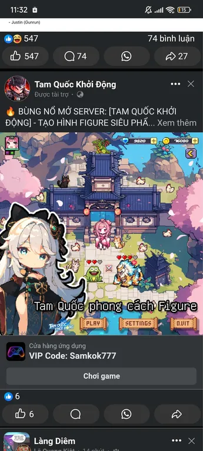

# Quy tắc mỹ thuật v1 — Linh Thú Ký

**Hướng được người dùng chọn ngày 04/10/2026:** game 2D chibi pixel art sáng màu, tạo hình nhân vật như figure, bối cảnh Đông Á chuyển thể sang tu tiên và ngự thú.

Tài liệu này là chuẩn mỹ thuật hiện hành cho nhân vật, linh thú, map, đồ vật, hiệu ứng và UI được tạo về sau. Các mẫu mỹ thuật cũ chỉ là lịch sử thử nghiệm. Thay đổi hướng này khi người dùng yêu cầu; các yêu cầu cụ thể mới của người dùng được ưu tiên.



## 1. Đọc đúng ảnh tham chiếu

Ảnh gốc là screenshot quảng cáo 345×768. Quan sát được: nhân vật nhỏ có đầu lớn; kiến trúc mái ngói xanh tím nhìn từ trên xuống, thấy mặt trước; nền đá kem và cỏ sáng; cây hồng bao khung; đá và mái có các mảng sáng tối rõ; đối tượng có viền tối và cách điệu mạnh.

Phần sân chơi ở giữa là tham chiếu chính. Chân dung lớn tóc trắng bên trái là lớp minh họa quảng cáo, không dùng làm tỷ lệ sprite trong thế giới. Khung Facebook, chữ quảng cáo, tên game, logo, mã VIP, số tiền và tim nổi không phải yêu cầu sản phẩm.

Không thể xác định chắc chắn kích thước pixel gốc, palette thật, engine hoặc cách tác giả tạo asset từ screenshot đã thu nhỏ. Các con số bên dưới là chuẩn sản xuất đề xuất cho dự án, không phải số đo của game tham chiếu. Nghiên cứu cách xử lý hình, rồi thiết kế nhân vật và kiến trúc riêng cho Linh Thú Ký.

## 2. Mười hai quy tắc bắt buộc

1. **Ngôn ngữ hình ảnh:** 2D chibi pixel art có hình khối rõ và nét gọn. Cụm pixel phải có chủ ý, cạnh chéo bậc thang dễ nhìn, hình vẫn đọc được ở kích thước chơi. Tranh lớn thu nhỏ hoặc bật Point filter chưa đủ để thành pixel art.
2. **Tỷ lệ nhân vật:** người chơi/NPC cao khoảng 2–2,5 đầu; đầu chiếm khoảng 40–50% chiều cao hình hữu dụng. Thân và chi ngắn, tóc thành các khối lớn, mắt có biểu cảm. “Figure” ở đây là thiết kế dễ nhận ra qua dáng, tóc và trang phục, với shading 2D gọn.
3. **Linh thú:** silhouette đặc trưng phải đọc được trước chi tiết. Huyền Giáp Quy có mai đen lớn chia thành mảng giáp, đường hoa văn vàng kim bám theo mai, đầu biểu cảm và bốn chân ngắn. Giữ khoảng trống giữa các đường vàng; phù ấn chính phải nhận ra ở kích thước chơi. Điểm tu tiên cần được thiết kế vào dáng và chất liệu, không phủ kín bằng trang sức. Thiết kế, dấu hiệu nhận diện và màu giữ ổn định qua animation.
4. **Viền:** dùng xanh đen hoặc tím than; nhân vật và vật tương tác có viền ngoài khoảng 1–2 pixel gốc. Viền trong nhẹ hơn viền ngoài. Nền xa giảm tương phản. Không dùng cùng một nét đen dày cho mọi viên đá và lá cây.
5. **Màu:** không khí sáng, màu sạch, có xanh lá, đá kem, mái xanh tím và điểm nhấn hồng/đỏ/vàng. Nền ít bão hòa hơn nhân vật. Mỗi chất liệu có 2–3 bậc màu rõ; toàn bộ bộ asset dùng khoảng 24–40 màu nền tảng, có thể bổ sung màu hệ khi cần.
6. **Ánh sáng:** ánh sáng ngày, hướng sáng mặc định từ trên trái. Tô theo mảng, bóng xanh tím tiết chế, bóng dưới chân nhỏ và mềm về hình khối. Hạn chế gradient, phản xạ bóng, lông vẽ từng sợi, sương sáng và bloom che hình.
7. **Góc nhìn:** orthographic 2D nhìn cao từ phía trước; thấy mặt trên và mặt trước của vật. Giữ cùng góc cho nhà, cây, đá, nhân vật và thú. Mặt đất theo lưới chữ nhật, chiều sâu thể hiện bằng lớp và độ che khuất.
8. **Kiến trúc tu tiên:** mái ngói xanh tím, đầu mái cong vừa phải, trụ gỗ, đèn lồng và biển hiệu đơn giản. Một công trình có một khối chính dễ đọc, có thể thêm tầng hoặc tháp làm điểm nhấn. Không biến từng viên ngói thành chi tiết siêu nhỏ.
9. **Thiên nhiên:** cây có tán thành vài khối lớn; lá/cánh hoa theo cụm; đá có mặt sáng và mặt tối lớn. Dùng cây hồng hoặc hoa làm điểm nhấn, cỏ xanh và đá kem làm nền. Mật độ chi tiết giảm ở vùng di chuyển.
10. **Bố cục map:** một điểm nhấn chính như cổng tông môn, linh viên hoặc cây linh. Cây, đá và kiến trúc bao hai bên; khoảng chơi ở giữa thoáng, đường đi đọc được ngay. Có lớp xa, lớp công trình, mặt đất, nhân vật và tiền cảnh; tiền cảnh không che lối đi quá nhiều.
11. **Hiệu ứng:** hình hiệu ứng bám màu hệ, ngắn và rõ hướng; ít hạt, không phủ ánh sáng toàn màn hình. Tách hiệu ứng khỏi sprite gốc để tái sử dụng. Tim, icon cảm xúc hoặc aura chỉ thêm khi gameplay cần.
12. **UI:** bảng gỗ, giấy hoặc khung màu ấm, viền gọn, icon rõ, nút có ba trạng thái bình thường/hover/nhấn. Chữ tiếng Việt phải đọc được ở kích thước thực tế; có thể dùng font nét sạch riêng cho chữ. Chân dung UI được vẽ chi tiết hơn sprite, nhưng giữ cùng thiết kế và màu nhân vật.

## 3. Palette khởi đầu

Các mã màu dưới đây là đề xuất v1, không phải palette trích chính xác từ screenshot. Các màu được chọn thêm phải cùng hệ màu và cùng cách chia bậc sáng tối.

**Palette hiện hành:** [Palette/linhthu-v2.gpl](Palette/linhthu-v2.gpl) (34 màu, có bản `.hex` và swatch PNG). V2 giữ nguyên 33 màu v1 và thêm đúng `#79AA5E` để làm mảng cỏ đậm nhẹ; không sửa palette v1 tại chỗ. File này giữ nguyên 12 màu dưới đây và thêm bậc sáng/tối cho từng chất liệu. Sprite sản xuất chỉ dùng màu trong file này; cần màu mới thì tạo phiên bản palette mới, không sửa tại chỗ.

| Vai trò | Màu nền tảng đề xuất | Cách dùng |
| --- | --- | --- |
| Viền chính | `#263046` | Nhân vật, mái, vật tương tác |
| Bóng tím | `#41405D` | Bóng mái và vật, tránh bóng đen thuần |
| Mái xanh | `#55678F` | Mái ngói, công trình tông môn |
| Mái sáng | `#899CBD` | Mép và mặt mái hứng sáng |
| Đá kem | `#E8DDB6` | Đường đi và sân |
| Đá tối | `#B1AD87` | Khe, cạnh và bóng đá |
| Cỏ xanh | `#83B865` | Nền cỏ và các cụm lá |
| Lá tối | `#4C8063` | Bậc tối cho cây, không phủ toàn map |
| Hoa hồng | `#E6A0B3` | Tán hoa và điểm nhấn |
| Vàng ấm | `#F1C86D` | Đèn, viền UI, chi tiết quan trọng |
| Đỏ điểm nhấn | `#C45E72` | Dây buộc, đèn lồng, trang phục |
| Xanh trời | `#8FCBE0` | Nền xa hoặc nước sáng |

Linh thú hiện hành theo yêu cầu ngày 05/10/2026: Huyền Giáp Quy, mai đen với hoa văn vàng kim. Mai dùng các bậc xanh đen/tím than đã có trong palette; vàng dùng tối–chính–sáng để gợi kim loại, không thêm gradient hoặc bloom. Màu đầu và chân hỗ trợ tương phản với mai. Linh quy xanh ngọc và linh hồ là các bản thử trước, không dùng làm thiết kế mặc định.

## 4. Chuẩn asset và Unity

Giữ `PPU = 16` và lưới nền 16×16 theo kế hoạch hiện có. 16×16 là ô nền, không bắt mọi nhân vật, cây hay nhà phải vừa một ô. Sprite lớn hơn dùng số pixel phù hợp nhưng cùng PPU, không phóng đại một phần bằng scale tùy tiện.

| Asset | Canvas gốc đề xuất | Yêu cầu |
| --- | --- | --- |
| Ô nền | 16×16 | Mảng lớn, nối được; ít chi tiết gây nhiễu |
| Người chơi/NPC | 32×48 | Chibi 2–2,5 đầu, có padding |
| Linh thú nhỏ | 32×32 | Tai, đầu và đuôi dễ phân biệt |
| Linh thú có đuôi dài | 48×48 | Giữ cùng kích thước ở mọi frame |
| Cây/đá/đồ vật | Bội số của 16 | Tách khỏi nền, pivot đặt tại điểm tiếp đất |
| Nhà/cổng | Từ 64×64 hoặc lớn hơn | Tách phần che nhân vật khi cần |
| Icon trong game | 16×16 hoặc 24×24 | Đọc được khi không phóng to |

Giữ canvas tham chiếu 384×256 của demo để thử asset; không đổi độ phân giải, renderer hoặc camera trong một task tạo hình nếu chưa có nhu cầu rõ. Khi sản xuất bộ asset chính, phải chốt một preset camera và tỷ lệ trước khi nhân rộng. Ảnh tham chiếu dọc không bắt buộc game web dùng bố cục dọc.

- PNG trong suốt cho nhân vật, đồ vật và hiệu ứng. PNG opaque được dùng cho nền hoặc tile kín.
- Alpha chỉ có 0 hoặc 255; mỗi frame nhân vật/linh thú tối đa 16 màu, prop lớn tối đa khoảng 20–24 màu. Kiểm tra bằng `AgentScripts/pixel/pixel_validate.py`; chuẩn hóa ảnh AI hoặc PixelLab bằng `AgentScripts/pixel/pixelize.py` (xem `AgentScripts/pixel/README.md`).
- World sprites: Point filter, mipmaps tắt, compression None; dùng Pixel Perfect Camera đúng với renderer đang có. Quy tắc này không áp dụng máy móc cho chân dung HD và font UI.
- Canvas, kích thước nhân vật, palette, trang phục, đuôi và pivot giữ cố định trong một animation. Các hướng nhìn có frame riêng; chỉ dùng flip khi thiết kế đối xứng cho phép.
- Khởi đầu bằng idle 4 frame và chạy 4–6 frame. Chân bám điểm tiếp đất, trọng tâm thân ổn định; tóc/đuôi là chuyển động phụ. Không đổi giải phẫu để tạo cảm giác chuyển động.
- Tách nền xa, tile nền, cây, đá, cổng, nhân vật và hiệu ứng. Một ảnh sân hoàn chỉnh chỉ dùng để chọn phong cách, không thay thế bộ map có thể ráp và chỉnh.

Demo ArtTrial cũ dùng bitmap lớn, nhiều PPU và sprite phóng lên. Nó là mẫu thử trước khi có chuẩn này, không dùng làm ví dụ kỹ thuật cho bộ asset chính. Task lập quy tắc không tự sửa scene, nhập lại texture hoặc thay thế asset cũ.

## 5. Quy trình tạo asset về sau

1. Đọc hướng dẫn này và ảnh tham chiếu; xác định loại asset, góc nhìn, canvas, palette và điểm tiếp đất.
2. Tạo một mẫu đại diện trước: một linh hồ hoặc một cổng, chưa sinh toàn bộ bộ asset. Thiết kế riêng cho thế giới tu tiên/ngự thú.
3. Kiểm tra mẫu ở kích thước chơi và phóng nguyên lần. Sửa silhouette, viền, cụm pixel và màu trước khi tạo animation hay biến thể.
4. Dùng mẫu nhất quán làm tham chiếu cho các frame/hướng nhìn. Chia ô và căn pivot trong công cụ sprite; giữ bitmap nguồn và prompt có phiên bản.
5. Đưa vào Unity cạnh một asset đã đạt chuẩn để kiểm tra tỷ lệ, góc nhìn, màu và animation. Ráp map bằng các phần tách rời khi chuyển sang sản xuất.
6. Đối chiếu đủ tám tiêu chí bên dưới; sửa mục không đạt trước khi nhân rộng. Không tự đổi phong cách vì một kết quả AI trông bắt mắt hơn.

ImageGen phù hợp để thử tạo hình và màu; PixelLab có thể dùng cho sprite/animation nếu đã kết nối; Aseprite hoặc công cụ pixel tương đương dùng để chỉnh lưới, palette và frame. Chọn công cụ theo khả năng thực tế của phiên, ghi rõ bước đã làm và chưa làm; không khẳng định đã chỉnh pixel thủ công khi chỉ sinh ảnh AI.

## 6. Prompt khung

Thay phần trong ngoặc và đính kèm ảnh tham chiếu khi công cụ hỗ trợ. Số canvas là kích thước asset gốc mong muốn; ảnh AI xuất lớn phải được chuẩn hóa trước khi coi là sprite sản xuất.

```text
Create an original [ASSET] for Linh Thu Ky, a bright Chinese-inspired cultivation and spirit-beast 2D game. Use the supplied reference for visual treatment only. Refined chibi pixel art, collectible-figure character design, readable silhouettes, deliberate pixel clusters, dark navy outlines, flat 2-3-step shading, warm cream stone, fresh green foliage, indigo blue roofs, restrained pink and amber accents. Elevated frontal top-down RPG view, orthographic, consistent with rectangular ground tiles.

For characters: 2-2.5-head chibi proportions, expressive eyes, compact body and limbs, a distinctive readable hairstyle or animal silhouette. For a spirit fox: large pointed ears, short recognizable fox muzzle, compact quadruped body, one expressive tail, a single elemental accent. [POSE / DIRECTION / FRAME COUNT]. Target native canvas: [WIDTH x HEIGHT]. Fixed scale and foot anchor across frames. Transparent background for isolated assets; clear unobstructed floor for environment samples.

No photorealism, glossy 3D toy rendering, painterly fur, airbrushed gradients, noisy micro-details, hazy bloom, mixed viewpoints, anatomy changes between frames, copied characters, advertising overlays, watermark or text. Exclude UI unless explicitly requested.
```

## 7. Checklist nghiệm thu — tám mục

- [ ] Nhìn ở kích thước chơi vẫn nhận ra chủ thể, không cần zoom để hiểu.
- [ ] Tỷ lệ chibi, nét viền và góc nhìn khớp với bộ asset hiện hành.
- [ ] Màu sáng, sạch; nhân vật/vật tương tác tách được khỏi nền.
- [ ] Cụm pixel có chủ ý, shading theo mảng; không có chi tiết nhiễu hoặc vùng nhòe. `pixel_validate.py` không báo FAIL (alpha 0/255, đúng palette, đủ giới hạn màu).
- [ ] Nếu là animation: đủ ô, nền trong suốt sạch, kích thước/pivot ổn định, hình dáng không trôi giữa frame.
- [ ] Nếu là map: lối đi rõ, có điểm nhấn chính, lớp che khuất hợp lý, props tách được để chỉnh.
- [ ] Import và tỷ lệ Unity đã được kiểm tra ở Game View; chưa nhập Unity thì ghi rõ đây mới là mẫu mỹ thuật.
- [ ] Thiết kế riêng, không còn khung quảng cáo, logo hoặc nhân vật sao chép từ ảnh nguồn.

## 8. Áp dụng cho dự án hiện tại

Dùng hướng chibi pixel art sáng màu đã chọn, với môi trường cổng–đá–hai cây anh đào–sân gạch/cỏ–hồ của bản v4. Người dùng chọn lại mức chi tiết của cổng và tán hoa v4; không tự đơn giản hóa chúng thành các mảng quá thô. Mật độ chi tiết tập trung ở tán cây, mái và vật thể, giữ vùng di chuyển thoáng. Huyền Giáp Quy thay linh quy xanh ngọc theo yêu cầu mới. Giữ cảnh mẫu nhỏ này trước khi mở rộng map. Gameplay và kiến trúc tiếp tục theo `game_architecture_plan.md`.

## Mẫu Huyền Giáp Quy v6 đang chờ duyệt

Nhánh `codex/huyen-giap-quy` bắt đầu từ môi trường v4 (`4247dcf`). Chỉ thay bộ PNG/animation của linh thú và tên hiển thị. Nguồn editable của Huyền Giáp Quy nằm trong `ArtDirection/Handmade/HuyenGiapQuy/`; nguồn rùa xanh cũ được giữ để đối chiếu. Bản môi trường đơn giản hóa v5 được giữ riêng trên nhánh `codex/art-style-sample`.

Khi duyệt, xem linh thú ở 1x cạnh cổng và tán hoa v4: mai vẫn đọc rõ là đen, đường vàng nhận ra nhưng không thành nhiễu, kích thước và góc nhìn khớp sân. Mai, hoa văn, mắt và giải phẫu ổn định qua idle và walk. V6 là mẫu cần người dùng duyệt, chưa tự coi thiết kế linh thú là bản cuối cùng.


## Nền cỏ — điều chỉnh theo ảnh 2 ngày 05/10/2026


Cỏ đọc thành một mặt xanh mướt, gần như phẳng; khoảng 90% trở lên vùng cỏ lộ ra giữ màu nền `#83B865`. Không rải chấm sáng, nét L, tick, sọc, pixel vụn hoặc nhịp lưới để mô tả từng ngọn cỏ. Chỉ dùng một hoặc hai mảng tối nhẹ `#79AA5E`, có silhouette rộng và tự nhiên, không viền hoặc dither; đặt lệch ở mép hoặc gần gốc cây. Bóng cây vẫn giữ riêng, không nhân bản mảng tối khắp sân. Hoa nhỏ chỉ đặt thưa sát mép; nền phải nhường độ tương phản cho cổng, tán cây và linh thú.

Mẫu map cần reviewer thẩm mỹ độc lập xem screenshot Unity ở kích thước chơi và thumbnail. Pixel validator chứng minh palette/alpha/kích thước, không chứng minh cảnh đẹp. Bản grass-a/b/c/d có các nét nhỏ rải đều trong thử nghiệm v7 đã bị người dùng loại; chúng không phải chuẩn để tạo nền sau này. Mẫu v7 đã sửa dùng `ArtDirection/Handmade/GardenV7/CleanGrass/`.
