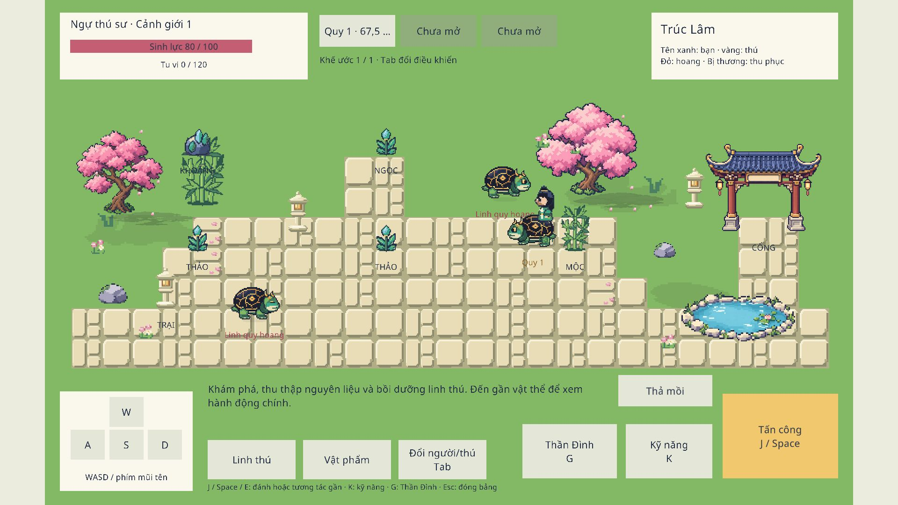

# Garden V8 — kiểm chứng ngày 06/10/2026

Bộ mười asset mới đã nhập và ráp vào map logic. Scene mẫu `Assets/ArtSample/SpiritTurtleGarden.unity`, luật gameplay và save không bị thay bởi lượt làm art này. Bộ nguồn: [Garden V8](../../../ArtDirection/Handmade/GardenV8/README.md).

- Unity plugin import và ApplyArt lưu scene bằng API. [Audit import](import-audit.json) xác nhận 10 texture, Point/PPU16/không mipmap/nén, 30 frame người 32×48 với pivot chân ổn định.
- Recompile thành công, 0 lỗi và 0 cảnh báo. [Build WebGL](build.json) thành công, 0 lỗi, 49.77 giây; tổng kích thước báo bởi Unity 63,553,589 byte trước nén/đóng gói.
- [Probe runtime](runtime-probe.json): 7 PASS, 0 FAIL trên nhiều frame Editor thật. Xác nhận người di chuyển và đủ sáu frame walk bên, trở lại idle, 14 cánh hoa thay đổi vị trí, ba gợn sáng chạy đủ bốn frame. Probe trả vị trí/điều khiển về giá trị ban đầu sau kiểm tra.
- [Validator nhân vật](player-validation.json) và [prop](props-validation.json) không FAIL/WARN. [Cỏ](grass-validation.json) không FAIL; cảnh báo thiếu viền là chủ ý để mảng cỏ hòa nền, mẫu A có một pixel lẻ. Không gọi toàn bộ validator là strict PASS.
- Mở lại đúng bản WebGL tại `http://127.0.0.1:8789/#choi` sau build; ảnh dưới là bản web thật và console trình duyệt không ghi lỗi trong lượt mở này.
- Reviewer mỹ thuật độc lập đã xem nguồn và screenshot: người/rùa hợp tỷ lệ, cỏ không rải nét vụn đều, trúc điểm MỘC sau thu nhỏ không chen vào rùa. Nhãn KHOÁNG hơi lẫn trúc trang trí bên trái là chi tiết còn có thể chỉnh sau; không chặn bản sơ bộ. Review ảnh tĩnh không chứng minh chuyển động; probe runtime sở hữu bằng chứng đó.

[Ảnh Unity trước lần thu nhỏ trúc điểm MỘC](unity-preview.png). Trứng dùng hình mới tại điểm trứng ở vùng Bờ Linh Hồ; screenshot Trúc Lâm không có điểm này. Hai vùng vẫn dùng chung bố trí art tạm, chưa phải thiết kế phòng cuối hoặc kiểm chứng tải online.

## Quay lại bản trước

Các file nguồn/scene/tài liệu trước lượt V8 nằm trong `before/`, giữ ngoài Assets để Unity không compile bản sao. Chỉ phục hồi các file muốn đổi, giữ save; nếu phục hồi cả presentation, dùng đủ `PrototypeMapArt.cs`, `GameplayHud.cs`, `LogicBuilder.cs` và scene tương ứng rồi mở/recompile/build bằng Unity. Không dùng git reset hoặc clean vì working tree có logic chưa commit. Mẫu mỹ thuật cũ và tag `art-v7-living-garden` vẫn được giữ riêng.
