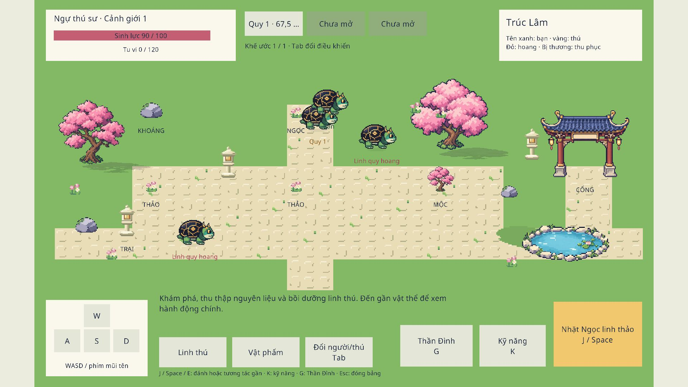

# Map logic dùng asset sân vườn — 05/10/2026

Scene: `Assets/_Project/Content/Scenes/ThanDinhPrototype.unity`. Bản web đã tải lại sau build tại `http://127.0.0.1:8789/#choi`.

## Phạm vi

Dùng lại grass-clean, tile lát sân, hai cây anh đào, đá, đèn, cổng, hồ, bóng và hoa của mẫu mỹ thuật. Người chơi, thú liên kết và thú hoang dùng bộ rùa idle/walk; vai trò phân biệt qua tên màu. `PrototypeMapArt` và `GameplayHud` sở hữu trình bày; `GameSession`, luật, save format và input command giữ nguyên. Cây và vật trang trí chưa có va chạm; hai vùng dùng chung bố trí tạm.

## Bằng chứng đã chạy

- Unity Pipeline `LogicBuilder.ApplyArt` lưu các tham chiếu sprite lên scene bằng Unity API.
- Recompile: thành công, 0 lỗi, 0 cảnh báo.
- WebGL build cuối: Succeeded, 34.54 giây, 63,514,603 byte chưa nén, 0 lỗi. Chi tiết trong `build.json`.
- Play Mode: phím A thay đổi vị trí người từ x=23.5 sang x=11.2748; sprite người là `turtle-walk-5`, các thú đứng yên dùng `turtle-idle-2`; đã thả phím sau kiểm tra.
- HUD integration chạy lại trên bản có asset: 7 đạt, 0 thất bại; xem `hud-tests.json`.
- Web thật: đã nhấn nút Đổi người/thú, trạng thái đổi từ Huyền Giáp Quy sang Ngự thú sư; tải lại build cuối vẫn giữ thú và tiến trình. Console trình duyệt không có error khi chụp ảnh.
- Unity Console không có error; Play đang mở.
- Reviewer độc lập gpt-6.1-sol max xem hai ảnh thật, đề nghị neo bóng cây sát gốc và nối gạch đến cổng. Đã sửa và reviewer xác nhận ảnh cuối đạt cho bản sơ bộ.
- `git diff --check` đạt; không có diff trong `Assets/ArtSample`. Không commit hoặc push.

Không chạy lại kiểm thử domain vì lượt này không thay luật. Đây là preview local, chưa phải thiết kế map hoặc kiểm chứng tải online cuối.

