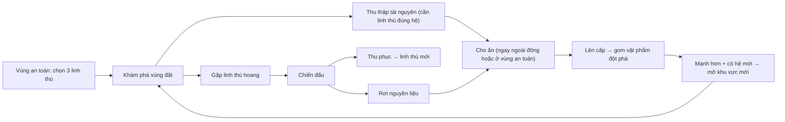
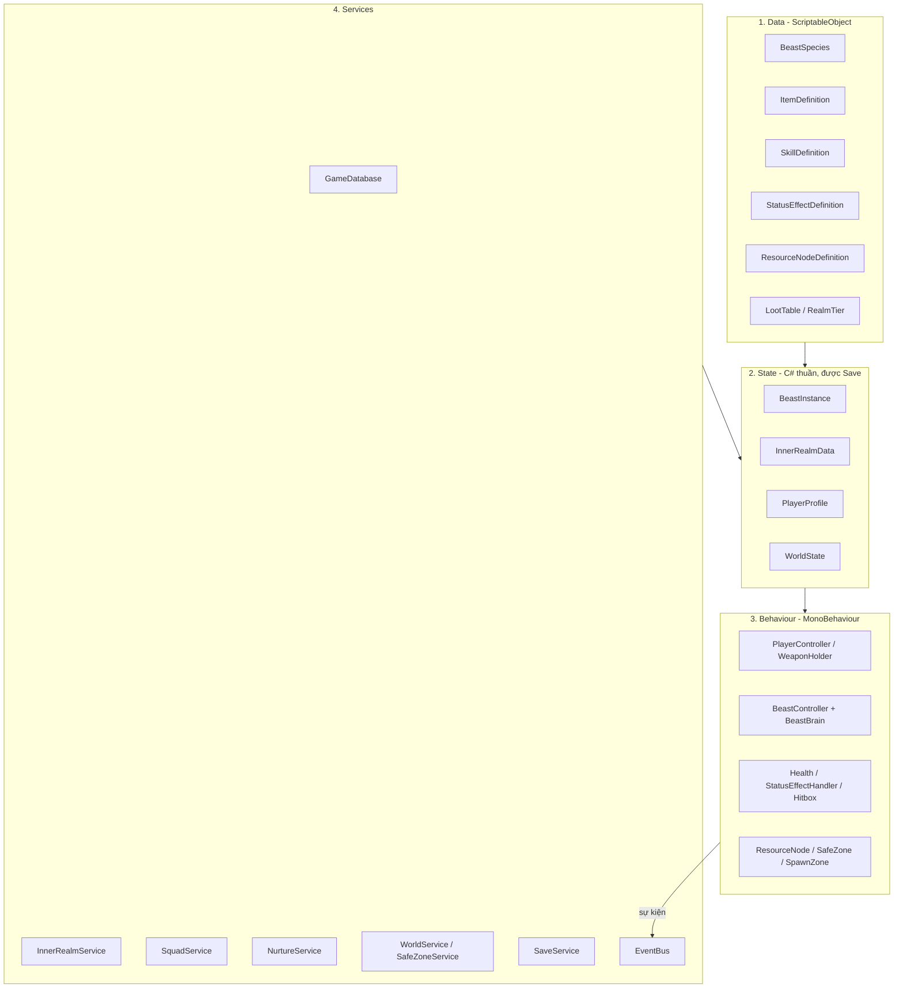
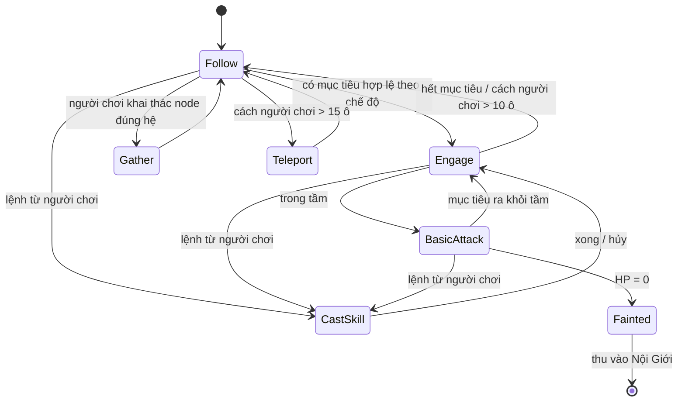
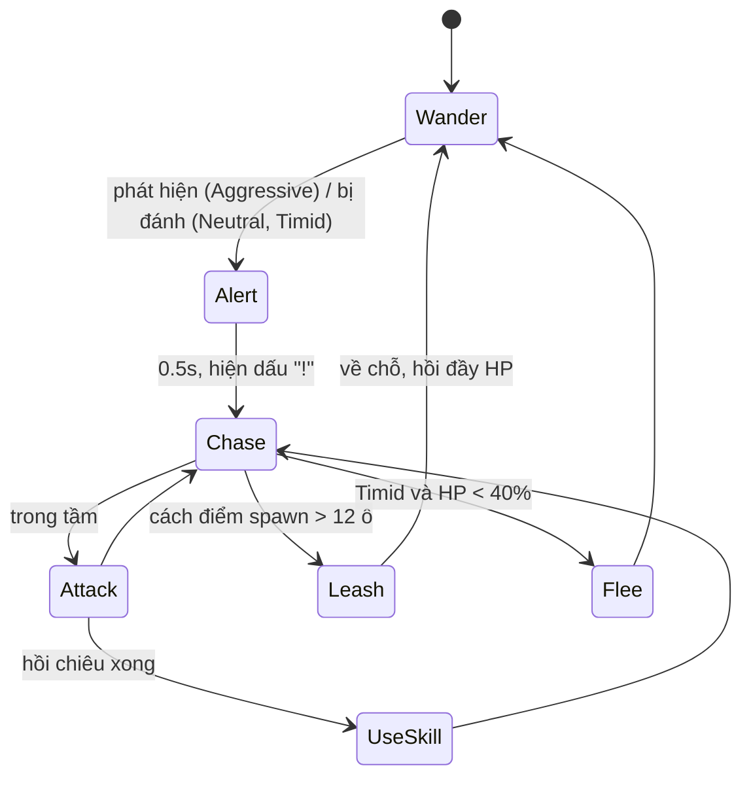

# 🐉 Linh Thú Ký — Kế hoạch Kiến trúc & Logic Lõi (v2)

> **Hướng mới 07/10/2026:** người chơi trực tiếp chiến đấu; tinh hạch/dung hợp/thiên phú là hướng tiếp theo. [GAME_DESIGN.md](GAME_DESIGN.md) sở hữu quyết định mới; giới hạn, chi phí và tẩy luyện chưa chốt. Mốc triển khai hiện hành: [Combat 01](Architecture/COMBAT_M1.md). Nội dung v2 bên dưới là lịch sử khi xung đột với hướng mới.

> **Yêu cầu online mới (05/10/2026):** xem [kiến trúc online theo vùng](Architecture/ONLINE_ARCHITECTURE.md) cho mục tiêu 100–300 người trên 20–30 phòng. Các phần kỹ thuật v2 dưới đây thiên về chơi đơn; JSON save, EventBus toàn cục và service locator không phải kiến trúc online đã chốt. Luật gameplay v2 tiếp tục là đầu vào thiết kế; lựa chọn thư viện và capacity trong tài liệu mới còn phải qua prototype/benchmark.

> **Gameplay mới (05/10/2026):** đọc [đặc tả gameplay và các quyết định còn mở](Architecture/GAMEPLAY_SPEC.md) trước khi code. Quyết định mới về Thần Đình, liên kết linh thú, bồi dưỡng và chuyển điều khiển thay thế các phần xung đột của v2. Các luật và thông số v2 còn lại là bản nháp tham khảo, không mặc nhiên đã được duyệt.
> Thể loại: 2D Top-down (kiểu Soul Knight) — **Nuôi dưỡng linh thú là chủ đạo**, khám phá & thu thập là phương tiện, chiến đấu đầy đủ nhưng đóng vai hỗ trợ.

**Thay đổi so với v1:** Unity 6000.6.4f1 · Nội Giới thay balo · ngất chỉ hồi ở vùng an toàn · 10 hệ · 3 linh thú cùng ra trận · người chơi chủ động kích kỹ năng · cho ăn là nguồn EXP chính · tài nguyên khóa theo hệ.

---

## 0. Quy ước bắt buộc (dán vào mọi prompt)

```text
BỐI CẢNH DỰ ÁN:
- Unity 6000.6.4f1, URP 2D Renderer, New Input System, Cinemachine 3.x, 2D Tilemap.
- Ô nền pixel art 16x16; sprite lớn hơn dùng bội số phù hợp. PPU = 16, Filter = Point, Compression = None, Pixel Perfect Camera.
- Mỹ thuật hiện hành: đọc ArtDirection/STYLE_GUIDE.md và ảnh tham chiếu trước khi tạo asset.
- PC (bàn phím + chuột) trước.

API UNITY 6 (không dùng API cũ):
- Rigidbody2D.linearVelocity (KHÔNG dùng .velocity), linearDamping (KHÔNG dùng .drag).
- FindAnyObjectByType / FindObjectsByType (KHÔNG dùng FindObjectOfType) — và chỉ dùng lúc khởi tạo.
- Bất đồng bộ dùng Awaitable / async (ưu tiên hơn Coroutine cho luồng load scene, save).
- Input: InputActionReference / generated C# class, KHÔNG dùng Input.GetKey.

QUY TẮC CODE:
1. Namespace theo thư mục: LinhThu.Core, LinhThu.Combat, LinhThu.Beasts, LinhThu.Realm, LinhThu.World ...
2. [SerializeField] private, không public field.
3. Không Find / GetComponent trong Update.
4. Dữ liệu tĩnh = ScriptableObject. Dữ liệu động = class C# thuần [Serializable].
5. Các module giao tiếp qua EventBus, không gọi chéo trực tiếp.
6. Subscribe trong OnEnable, Unsubscribe trong OnDisable.
7. Manager cấp game lấy qua Services.Get<T>(), không Singleton tự chế.
8. Mọi định nghĩa có string Id duy nhất (vd "beast_fox_fire").
9. Không tự đổi interface/class trong mục 5. Nếu buộc phải đổi → ghi rõ lý do ở đầu câu trả lời.
10. Trả về: danh sách file tạo/sửa + code đầy đủ + hướng dẫn setup Editor + cách test.
```

---

## 1. Tầm nhìn Game

| Ưu tiên | Trụ cột | Ý nghĩa |
| :--: | :--- | :--- |
| 1 | **Nuôi dưỡng** | Cho ăn đúng thức ăn → lên cấp → đột phá cảnh giới. Đây là mục tiêu dài hạn của người chơi. |
| 2 | **Khám phá & thu thập** | Thế giới rộng, mỗi vùng có tài nguyên hợp với các hệ khác nhau. Nhiều tài nguyên **cần linh thú đúng hệ** mới khai thác được. |
| 3 | **Chiến đấu** | Người chơi đánh trực tiếp + 3 linh thú tự đánh thường; người chơi **chủ động kích kỹ năng** của từng con. |

### Core Loop



### Phạm vi MVP
- Nhân vật chính (cáo) + 1 vũ khí tầm xa + 1 vũ khí cận chiến.
- **Đủ 10 hệ trong hệ thống**; nội dung chơi được đầu tiên: **6 loài** (mục 8), 4 loài còn lại thêm ở Phase 6.
- 2 vùng đất + Linh Viên (base) + 2 Linh Trận (điểm an toàn trong vùng).
- Nội Giới, thu phục, 3 linh thú ra trận, cho ăn, lên cấp, đột phá cảnh giới 1.
- Hiệu ứng trạng thái theo hệ, Save/Load.
- ❌ Chưa làm: tiến hóa hình dạng, nấu ăn/chế tạo, ngày/đêm, phản ứng nguyên tố, nhiệm vụ, mobile.

---

## 2. Lore & Cơ chế Nội Giới

> Người chơi mang trong cơ thể một **Nội Giới**, tức một không gian riêng chứa được linh thú đã khế ước và vật phẩm. Nội Giới thay cho khái niệm balo hay nhẫn trữ vật.

| Thành phần | Quy tắc |
| :--- | :--- |
| **Ô vật phẩm** | Bắt đầu 24 ô, mỗi ô 1 stack. Nâng cấp +8 ô bằng Linh Thạch tại Linh Viên. |
| **Giới hạn khế ước** | Tổng số linh thú mang theo (trong Nội Giới + đang ra trận), bắt đầu 5, nâng cấp +1. **Đầy thì không thu phục được**; thú dư gửi Kho Linh Viên (không giới hạn). |
| **Ra trận** | Tối đa **3** linh thú ra trận cùng lúc. Triệu hồi/thu hồi lúc nào cũng được (thời gian hồi 2s/con), **trừ thú đã ngất**. |
| **Ngất** | HP = 0 → tự bị thu vào Nội Giới, trạng thái `Fainted`. **Không triệu hồi được, không vật phẩm nào hồi được ngoài vùng an toàn.** |
| **Vùng an toàn** | Linh Viên + Linh Trận trong mỗi vùng. Ở đây thú ngất triệu hồi được (ra với 1 HP); mọi thú đang ra trận hồi 5% HP/giây. Linh Trận đồng thời là điểm dịch chuyển nhanh và điểm hồi sinh. |
| **Người chơi gục** | Hồi sinh ở vùng an toàn gần nhất, mất 20% số lượng mỗi stack **tài nguyên** (không mất thức ăn hiếm, vật phẩm khế ước, linh thú). Gọi là "Nội Giới chấn động". *(Thông số có thể chỉnh)* |

**Vì sao thiết kế như vậy:** luật ngất buộc người chơi tính toán đường đi giữa các Linh Trận. Linh thú tuy không chết vĩnh viễn nhưng ngất vẫn gây tổn thất thật, nên chiến đấu có ý nghĩa mà không quá trừng phạt.

---

## 3. Hệ thống 10 Hệ

**Ngũ hành:** Kim, Mộc, Thủy, Hỏa, Thổ · **Dị hệ:** Băng, Lôi, Phong · **Âm Dương:** Quang, Ám

### 3.1 Quan hệ khắc chế
Mỗi hệ trong 8 hệ (Ngũ hành + Dị hệ) đều **khắc đúng 2 hệ và bị khắc bởi đúng 2 hệ**, để không hệ nào vượt trội.

| Hệ | Khắc (gây x1.5) | Bị khắc bởi | Ý nghĩa |
|:--|:--|:--|:--|
| **Kim** | Mộc, Lôi | Hỏa, Thủy | Rìu chặt cây; kim loại thu lôi |
| **Mộc** | Thổ, Phong | Kim, Băng | Rễ xuyên đất; rừng chắn gió |
| **Thủy** | Hỏa, Kim | Thổ, Lôi | Nước dập lửa; nước làm gỉ sắt |
| **Hỏa** | Kim, Băng | Thủy, Thổ | Lửa nung chảy kim loại, làm tan băng |
| **Thổ** | Thủy, Hỏa | Mộc, Phong | Đê ngăn nước; đất vùi lửa |
| **Băng** | Mộc, Phong | Hỏa, Lôi | Cây chết rét; gió bị đóng băng |
| **Lôi** | Thủy, Băng | Kim, Phong | Nước dẫn điện; sét phá băng |
| **Phong** | Thổ, Lôi | Mộc, Băng | Gió xói mòn đất; gió tán mây giông |
| **Quang** | Ám | Ám | Âm dương khắc nhau **hai chiều** |
| **Ám** | Quang | Quang | |

```text
Hệ số sát thương (attacker → defender):
- Attacker khắc defender:        x1.5
- Defender khắc attacker:        x0.75
- Cùng hệ:                       x0.75
- Quang ↔ Ám:                    x1.5 (cả hai chiều)
- Còn lại / hệ None (vũ khí thường): x1.0
```
> Quang và Ám là **hệ hiếm**: trung tính với 8 hệ còn lại, mạnh khi gặp nhau, chỉ xuất hiện ở khu vực đặc biệt.

### 3.2 Hiệu ứng trạng thái theo hệ
Mỗi kỹ năng có `StatusChance` (0–1). Đòn đánh thường có xác suất thấp (10%).

| Hệ | Hiệu ứng | Tác dụng |
|:--|:--|:--|
| Kim | **Phá Giáp** | -25% DEF trong 4s |
| Mộc | **Trói Buộc** | Không di chuyển được 1.5s (vẫn đánh được) |
| Thủy | **Ẩm Ướt** | 5s; nhận +30% sát thương Lôi, tích Hàn Khí nhanh gấp 2 |
| Hỏa | **Thiêu Đốt** | 3s, cứ 0.5s mất 5% ATK của người gây |
| Thổ | **Choáng** | Đứng yên, không hành động 0.6s |
| Băng | **Hàn Khí** | -30% tốc độ, cộng dồn 3 lần → **Đóng Băng** 1.5s |
| Lôi | **Tê Liệt** | Ngắt chiêu đang niệm + đứng yên 0.4s |
| Phong | **Thổi Bay** | Đẩy lùi mạnh x3, va tường thì Choáng 0.3s |
| Quang | **Chói Lòa** | 30% đánh trượt trong 3s |
| Ám | **Ăn Mòn** | -20% ATK 4s; người gây hút 10% sát thương thành HP |

Quy tắc cộng dồn: cùng hiệu ứng thì **làm mới thời gian** (riêng Hàn Khí thì cộng dồn). Sau khi hết Choáng, Đóng Băng hoặc Tê Liệt, mục tiêu **miễn các hiệu ứng khống chế này 2s** để tránh bị khống chế liên tục.

---

## 4. Kiến trúc Kỹ thuật

### 4.1 Bốn lớp



> **Quy tắc vàng:** `BeastController` trên scene chỉ là "thân xác". Dữ liệu thật (`BeastInstance`) luôn nằm trong `InnerRealmService`. Thú bị thu hồi hay ngất thì GameObject bị hủy (hoặc trả về pool), còn dữ liệu vẫn giữ nguyên.

### 4.2 Trách nhiệm từng Service

| Service | Trách nhiệm | Không được làm |
|:--|:--|:--|
| `GameDatabase` | Tra cứu mọi SO theo Id | Giữ trạng thái |
| `InnerRealmService` | Giữ vật phẩm + danh sách linh thú khế ước; thêm/bớt; giới hạn | Spawn GameObject |
| `SquadService` | 3 slot ra trận: triệu hồi/thu hồi/spawn, chuyển lệnh kỹ năng và chế độ ra lệnh | Tính EXP, sửa vật phẩm trực tiếp |
| `NurtureService` | Cho ăn, EXP, lên cấp, đột phá, độ no giảm dần theo thời gian | Chiến đấu |
| `TamingService` | Tính tỷ lệ, tạo BeastInstance mới | |
| `SafeZoneService` | Biết người chơi đang ở vùng an toàn không, hồi máu, cho phép triệu hồi thú ngất | |
| `WorldService` | Load vùng (additive), node đã khai thác, thời gian chơi | |
| `SaveService` | Ghi và đọc JSON, migrate theo Version | |

### 4.3 Scene

```text
Bootstrap.unity        (Services, không bao giờ unload)
├─ UI.unity            (HUD, Nội Giới UI)
├─ Sanctuary.unity     (Linh Viên - vùng an toàn lớn)
├─ Region_Forest.unity (Rừng Mộc Linh ~160x160 tile, có 1 Linh Trận)
└─ Region_Hills.unity  (Đồi Xích Thạch ~160x160 tile, có 1 Linh Trận)
```

### 4.4 Thư mục

```text
Assets/_Project/
├─ Art/  Data/  Prefabs/  Scenes/  Settings/
└─ Scripts/
   ├─ Core/      (EventBus, Services, Bootstrap, GameEvents, ElementChart)
   ├─ Data/      (định nghĩa ScriptableObject)
   ├─ Player/
   ├─ Combat/    (Health, DamageInfo, DamageCalculator, Hitbox, Projectile, StatusEffects/)
   ├─ Beasts/    (BeastInstance, BeastController, Brain/, Skills/)
   ├─ Realm/     (InnerRealmService, SquadService, NurtureService, TamingService)
   ├─ World/     (RegionLoader, SafeZone, ResourceNode, SpawnZone, Gate)
   ├─ Save/
   └─ UI/
```

### 4.5 Physics2D Layers

| Layer | Va chạm với |
|:--|:--|
| `Player` | Environment, EnemyHitbox, Pickup, Interactable, SafeZone |
| `Ally` | Environment, EnemyHitbox |
| `Enemy` | Environment, PlayerHitbox |
| `PlayerHitbox` (đòn của người chơi + linh thú phe ta) | Enemy, Environment |
| `EnemyHitbox` | Player, Ally, Environment |
| `Environment` | Tất cả |
| `Pickup`, `Interactable`, `SafeZone` | Player |

Sắp xếp hiển thị: `Transparency Sort Axis = (0, 1, 0)`, pivot sprite ở chân.

---

## 5. Hợp đồng Code Lõi

### 5.1 Core

```csharp
namespace LinhThu.Core
{
    public static class EventBus<T> where T : struct
    {
        public static event System.Action<T> OnEvent;
        public static void Raise(T evt) => OnEvent?.Invoke(evt);
    }

    public static class Services
    {
        public static void Register<T>(T service) where T : class;
        public static T Get<T>() where T : class;
        public static bool TryGet<T>(out T service) where T : class;
    }

    public enum Element { None, Kim, Moc, Thuy, Hoa, Tho, Bang, Loi, Phong, Quang, Am }
    public enum Faction { Player, Ally, Enemy, Neutral }

    public static class ElementChart
    {
        // Bảng mục 3.1, dạng dữ liệu tĩnh trong code (không cho chỉnh lúc runtime)
        public static float GetMultiplier(Element attacker, Element defender);
        public static bool Counters(Element attacker, Element defender);
    }
}
```

### 5.2 Sự kiện chuẩn (`Core/GameEvents.cs`)

```csharp
public struct DamageDealtEvent       { public GameObject Target; public DamageInfo Info; public int FinalAmount; public float ElementMult; }
public struct EntityDiedEvent        { public GameObject Entity; public Faction Faction; public string SpeciesId; public int Level; }
public struct StatusAppliedEvent     { public GameObject Target; public string StatusId; }

public struct BeastSummonedEvent     { public BeastInstance Beast; public int Slot; }
public struct BeastRecalledEvent     { public BeastInstance Beast; public int Slot; }
public struct BeastFaintedEvent      { public BeastInstance Beast; }
public struct BeastSkillCastEvent    { public BeastInstance Beast; public string SkillId; }
public struct BeastTamedEvent        { public BeastInstance Beast; }
public struct TameFailedEvent        { public GameObject WildBeast; public bool Fled; }

public struct BeastFedEvent          { public BeastInstance Beast; public string ItemId; public int ExpGained; public bool Favorite; }
public struct BeastLevelUpEvent      { public BeastInstance Beast; public int NewLevel; }
public struct BeastBreakthroughEvent { public BeastInstance Beast; public int NewRealm; }

public struct ItemChangedEvent       { public string ItemId; public int Delta; public int NewTotal; }
public struct ResourceGatheredEvent  { public string NodeId; public string ItemId; public int Amount; }
public struct SafeZoneChangedEvent   { public bool IsInside; public string ZoneId; }
public struct PlayerDiedEvent        { }
public struct RegionLoadedEvent      { public string RegionId; }
```

### 5.3 ScriptableObject

```csharp
public enum Temperament { Aggressive, Neutral, Timid }
public enum ItemCategory { Resource, Food, Contract, Breakthrough, Consumable }
public enum SkillShape { Melee, Projectile, AreaAroundSelf, AreaAtTarget, Dash, Heal, Buff }

[CreateAssetMenu(menuName = "LinhThu/Beast Species")]
public class BeastSpecies : ScriptableObject
{
    public string Id; public string DisplayName; public Element Element;
    public Temperament Temperament; public int Rarity;      // 1–5
    public GameObject Prefab; public Sprite Icon;

    [Header("Chỉ số cấp 1 / tăng mỗi cấp")]
    public int BaseHP, BaseATK, BaseDEF; public float MoveSpeed;
    public float GrowthHP, GrowthATK, GrowthDEF;

    [Header("Chiến đấu")]
    public SkillDefinition BasicAttack;     // tự động
    public SkillDefinition ActiveSkill;     // người chơi kích

    [Header("Nuôi dưỡng")]
    public ItemDefinition[] FavoriteFoods;  // x1.5 EXP, x2 thân mật
    public RealmTier[] Realms;              // các cảnh giới & vật phẩm đột phá

    [Header("Thu phục & thu thập")]
    [Range(0, 1)] public float BaseCatchRate;
    public float GatherSpeedBonus = 0.5f;   // áp dụng cho node có RequiredElement == Element
    public LootTable WildDropTable;
}

[CreateAssetMenu(menuName = "LinhThu/Item")]
public class ItemDefinition : ScriptableObject
{
    public string Id; public string DisplayName; public Sprite Icon;
    public ItemCategory Category; public int MaxStack = 99;
    public Element Element;          // None = trung tính
    public int Tier = 1;             // 1 Phàm, 2 Linh, 3 Bảo
    [Header("Food")] public int SatietyValue; public int NutritionExp; public int BondValue; public float HealPercent;
    [Header("Contract")] public float SealPower = 1f;
}

[CreateAssetMenu(menuName = "LinhThu/Skill")]
public class SkillDefinition : ScriptableObject
{
    public string Id; public string DisplayName; public Element Element;
    public SkillShape Shape; public int Power = 100;   // % ATK (Heal: % MaxHP)
    public float Cooldown = 1f; public float Range = 1.5f; public float Radius = 0f;
    public float CastTime = 0f;                         // > 0 thì có thể bị Tê Liệt ngắt
    public StatusEffectDefinition Status; [Range(0, 1)] public float StatusChance;
    public GameObject EffectPrefab;
}

[CreateAssetMenu(menuName = "LinhThu/Status Effect")]
public class StatusEffectDefinition : ScriptableObject
{
    public string Id; public Element Element; public float Duration; public float TickInterval;
    public float Magnitude; public int MaxStacks = 1; public bool IsCrowdControl;
    public StatusEffectDefinition OnMaxStacks;          // Hàn Khí x3 → Đóng Băng
}

[CreateAssetMenu(menuName = "LinhThu/Resource Node")]
public class ResourceNodeDefinition : ScriptableObject
{
    public string Id; public Element RequiredElement;   // None = ai cũng khai thác được
    public LootTable Yield; public float GatherTime = 1.5f;
    public int MaxHits = 3; public float RespawnSeconds = 300f;
}

[System.Serializable] public class RealmTier
{
    public string Name;                  // "Ấu Linh", "Thành Linh", "Linh Vương"
    public int MaxLevel;                 // 10, 20, 30
    public float StatMultiplier;         // 1.0, 1.15, 1.35
    public ItemCost[] BreakthroughCost;  // để lên cảnh giới NÀY
}
[System.Serializable] public struct ItemCost { public ItemDefinition Item; public int Amount; }

[CreateAssetMenu(menuName = "LinhThu/Loot Table")]
public class LootTable : ScriptableObject
{
    [System.Serializable] public struct Entry { public ItemDefinition Item; public int Min, Max; [Range(0,1)] public float Chance; }
    public Entry[] Entries;
    public List<ItemCost> Roll(System.Random rng);
}
```

### 5.4 State

```csharp
[System.Serializable]
public class BeastInstance
{
    public string Uid; public string SpeciesId; public string Nickname;
    public int Level = 1; public int Exp; public int RealmIndex;   // 0 = Ấu Linh
    public float Potential;          // Tư chất 0.8–1.2
    public int Bond;                 // 0–100
    public float Satiety = 100f;     // 0–100
    public int CurrentHP; public bool IsFainted;
    public BeastLocation Location;   // InnerRealm, Squad, SanctuaryStorage
    public bool AutoCastSkill;       // người chơi bật/tắt

    // Tính toán, không lưu (cache Species):
    public int MaxHP { get; } public int ATK { get; } public int DEF { get; }
    public int LevelCap { get; }     // theo RealmIndex
}
public enum BeastLocation { InnerRealm, Squad, SanctuaryStorage }

[System.Serializable] public class ItemStack { public string ItemId; public int Amount; }

[System.Serializable] public class InnerRealmData
{
    public int ItemSlotCapacity = 24; public int ContractLimit = 5;
    public List<ItemStack> Items = new();
    public List<BeastInstance> Beasts = new();      // mọi thú khế ước, kể cả đang ra trận / ở kho
    public string[] SquadUids = new string[3];      // null = slot trống
}

[System.Serializable] public class SaveData
{
    public int Version = 1; public double PlayTimeSeconds;
    public PlayerProfile Player; public InnerRealmData Realm; public WorldState World;
}
```

### 5.5 API Service chính

```csharp
public interface IInnerRealmService
{
    InnerRealmData Data { get; }
    int CountItem(string itemId);
    bool TryAddItem(string itemId, int amount, out int overflow);
    bool TryRemoveItem(string itemId, int amount);
    bool CanContract { get; }                       // còn chỗ khế ước
    void AddBeast(BeastInstance beast);
    IEnumerable<BeastInstance> CarriedBeasts { get; }  // InnerRealm + Squad
}

public interface ISquadService
{
    BeastController GetController(int slot);        // null nếu trống
    bool TrySummon(string beastUid, int slot);      // lỗi nếu Fainted và không ở vùng an toàn
    void Recall(int slot);
    void CastSkill(int slot, Vector2 worldTarget);  // người chơi bấm 1/2/3
    void SetCommandMode(SquadCommand mode);
}
public enum SquadCommand { Attack, Defend, Passive }

public interface INurtureService
{
    FeedResult Feed(string beastUid, string itemId); // kiểm tra no, tính EXP, phát event
    bool CanBreakthrough(string beastUid, out List<ItemCost> missing);
    bool Breakthrough(string beastUid);
    void AddCombatExp(string beastUid, int amount);
}
public enum FeedResult { Success, Full, Refused, NoItem, Fainted }
```

### 5.6 Chiến đấu

```csharp
public struct DamageInfo
{
    public int Amount; public Element Element; public Faction SourceFaction; public GameObject Source;
    public Vector2 Knockback; public bool IsCrit; public SkillDefinition Skill;
}
public interface IDamageable { Faction Faction { get; } Element Element { get; } int DEF { get; } void TakeDamage(DamageInfo info); }

// Health : MonoBehaviour, IDamageable — event OnHealthChanged(cur,max), OnDied; i-frame người chơi 0.3s
// StatusEffectHandler : MonoBehaviour — Apply(def, source), Has(id), modifier: MoveSpeedMult, AtkMult, DefMult, CanMove, CanAct
// DamageCalculator (static) — Compute(attackerATK, DamageInfo, IDamageable target) → int
```

---

## 6. Logic Lõi & Công thức

### 6.1 Sát thương
```text
raw       = ATK * Skill.Power / 100 * AtkMult(status)
mitigated = raw * 100 / (100 + DEF * DefMult(status))
final     = mitigated * ElementChart.GetMultiplier(atk, def) * (crit ? 1.5 : 1) * Random(0.9, 1.1)
final     = max(1, round(final))       Crit mặc định 5%
Hiện số: x1.5 màu vàng + chữ "Khắc!", x0.75 màu xám.
```

### 6.2 Nuôi dưỡng (trụ cột chính)

**Cho ăn**, áp dụng mọi nơi miễn là thú **không ngất**:
```text
Điều kiện: Satiety < 100. Nếu không → FeedResult.Full

affinity:
  food.Element == beast.Element                 → 1.5  (Hợp hệ)
  food.Element khắc beast.Element               → 0.5  và 50% thú từ chối (Refused, mất món, -2 Bond)
  còn lại / None                                → 1.0
favorite = FavoriteFoods chứa món → 1.5

exp     = NutritionExp * TierMult(1 / 2 / 4) * affinity * favorite * (1 + Bond/200)
satiety += SatietyValue (tối đa 120, tức được "no căng" một chút)
bond    += BondValue * (favorite ? 2 : 1)       (tối đa 100)
hp      += HealPercent * MaxHP
```

**Độ no giảm dần** (theo thời gian chơi):
| Vị trí | Giảm |
|:--|:--|
| Đang ra trận | 1 / 20s |
| Trong Nội Giới | 1 / 90s |
| Kho Linh Viên | 0 (máng ăn tự lo) |

Độ no < 30: -15% chỉ số. Độ no = 0: -30% chỉ số và không nhận EXP.
→ **Độ no là cái giới hạn tự nhiên**: không thể cho ăn liên tục để lên cấp tức thì, người chơi phải đi khám phá rồi quay lại cho ăn.

**EXP & cấp:**
```text
expToNext(level) = round(20 * level^1.6)
Nguồn EXP: Cho ăn (chính, ~70%) · Chiến đấu (phụ): 5 * enemyLevel chia đều cho thú đang ra trận
Đạt LevelCap của cảnh giới hiện tại → EXP dừng, hiện nút "Đột phá"
```

**Cảnh giới & Đột phá (MVP: 3 cảnh giới):**
| Cảnh giới | Cấp | Hệ số chỉ số | Vật phẩm đột phá (ví dụ cho thú hệ X) |
|:--|:--|:--|:--|
| Ấu Linh | 1–10 | x1.0 | — |
| Thành Linh | 11–20 | x1.15 | 10 Linh Thạch hệ X + 3 Linh Thảo hiếm + 1 Đột Phá Quả |
| Linh Vương | 21–30 | x1.35 | 20 Linh Thạch hệ X + 1 tinh hạch hệ X (rơi từ thú hoang cấp cao) |

Đột phá chỉ thực hiện ở **vùng an toàn**. Đột phá thành công: hồi đầy HP, tăng sức mạnh kỹ năng +20%.
→ Mỗi hệ cần **Linh Thạch của hệ đó**, buộc người chơi đi đúng vùng, đúng node.

**Chỉ số:**
```text
Stat = (Base + Growth*(Level-1)) * Potential * RealmMult * (1 + Bond/500) * HungerMult
```

### 6.3 Thu phục
```text
Dùng Khế Ước Phù (phím F, ném về hướng chuột). Điều kiện: CanContract == true (nếu không, UI báo "Nội Giới đã đầy").

hpFactor  = 1 - currentHP/maxHP
weakBonus = HP < 30% ? 1.5 : 1.0
ccBonus   = đang Choáng/Đóng Băng/Trói ? 1.25 : 1.0     (thưởng cho người biết phối hợp kỹ năng)
foodBonus = trúng món yêu thích trong 30s qua ? 1.3 : 1.0 (ném thức ăn = phím G)
levelPen  = clamp(1 - (wildLv - avgSquadLv) * 0.05, 0.5, 1.2)

chance = clamp(BaseCatchRate * (0.3 + 0.7*hpFactor) * weakBonus * ccBonus * foodBonus * SealPower * levelPen, 0.02, 0.95)

Thành công → BeastInstance (Potential 0.8–1.2, Bond 10, HP 50%, Location = InnerRealm)
Thất bại   → mất phù; Timid: 60% bỏ chạy · khác: 25% bỏ chạy, còn lại Cuồng Nộ (+20% ATK 5s)
```

### 6.4 Đội hình 3 linh thú & ra lệnh

**Đội hình:** 3 vị trí lệch so với người chơi, xoay theo hướng di chuyển: `(-1.2, -0.6)`, `(1.2, -0.6)`, `(0, -1.4)`.

**Chế độ ra lệnh (phím Q đổi vòng):**
| Chế độ | Hành vi |
|:--|:--|
| Tấn công | Tự tìm và đánh kẻ địch trong 6 ô |
| Phòng thủ | Chỉ đánh kẻ đang tấn công người chơi/đồng đội hoặc ở trong 3 ô |
| Bị động | Không đánh, chỉ theo sau và hỗ trợ thu thập |

**Kích kỹ năng chủ động:** phím **1 / 2 / 3** → `SquadService.CastSkill(slot, mouseWorld)`.
```text
- Thú ngất / không ra trận / còn cooldown → UI rung icon + âm báo, không làm gì.
- Ngoài tầm → thú chạy vào tầm (tối đa 1.5s, quá thì hủy lệnh, không tính cooldown).
- Đang bị Choáng/Đóng Băng/Tê Liệt → lệnh xếp hàng, thực hiện khi hết (tối đa 1s).
- Skill dạng Heal/Buff nhắm vào người chơi hoặc đồng đội HP thấp nhất trong tầm.
- Ctrl + 1/2/3 → bật/tắt AutoCastSkill cho slot đó (AI tự dùng khi hồi chiêu xong và có mục tiêu).
```
**Phân chia mục tiêu:** khi có nhiều kẻ địch, mỗi thú ưu tiên kẻ chưa bị đồng đội nhắm. Thứ tự ưu tiên: (1) kẻ đang đánh người chơi, (2) kẻ người chơi vừa đánh trúng, (3) kẻ bị khắc hệ, (4) gần nhất.

### 6.5 Companion AI (FSM)


- Mọi trạng thái kiểm tra `StatusEffectHandler.CanMove/CanAct` trước khi hành động.
- Di chuyển: **NavMeshPlus** (NavMesh 2D). ⚠️ Task 0.5 phải kiểm tra tương thích với 6000.6. Nếu lỗi thì dùng **A\* Pathfinding Project (bản free)**.

### 6.6 Wild AI (FSM)


Linh thú hoang dùng **cùng** `BeastController`, `SkillExecutor`, `StatusEffectHandler` như thú phe ta, chỉ khác Brain và Faction.

### 6.7 Thu thập (gắn với hệ)

```text
- Người chơi giữ E gần node → thanh tiến trình GatherTime.
- Node có RequiredElement ≠ None:
    · Phải có thú cùng hệ đang ra trận, nếu không: hiện icon hệ cần + "Cần linh thú hệ X".
    · Thú đó chạy đến node, chơi animation hỗ trợ; tốc độ x(1 + GatherSpeedBonus).
- Hết 1 nhịp: roll Yield → Nội Giới (đầy thì rơi xuống đất thành Pickup, tồn tại 120s).
- Hết MaxHits → node cạn, lưu respawnAt (theo PlayTimeSeconds) vào WorldState.
```

| Node | Hệ cần | Cho ra | Vùng |
|:--|:--|:--|:--|
| Cây gỗ, bụi quả | — | Gỗ, Linh Quả | Mọi vùng |
| Đá thường | — | Đá | Mọi vùng |
| Cây cổ thụ cao | Phong | Quả Gió, Lông Vũ | Rừng |
| Hồ linh tuyền | Thủy | Ngọc Trai Thủy, Cá Linh | Rừng |
| Mạch quặng sâu | Thổ | Linh Thạch Thổ / Kim | Đồi |
| Khối băng phong ấn | Hỏa | Băng Tinh | Đồi (đỉnh), Tuyết Sơn |
| Dây leo phong tỏa | Kim | Mở lối đi mới + Linh Thảo | Rừng |
| Cột lôi tàn | Lôi | Lôi Tinh | Phase 6 |
| Hoa nở đêm trong hang | Quang | Ám Hoa | Hang Đồi |
| Đền ánh sáng | Ám | Quang Tinh | Phase 6 |

→ Mỗi loài mới thu phục **mở thêm tài nguyên**, tài nguyên lại dùng để **nuôi loài khác**. Đây là sợi dây nối 3 trụ cột với nhau.

### 6.8 Spawn & Vùng an toàn
- **SpawnZone** (trigger): danh sách loài + trọng số + cấp min/max + số lượng tối đa. Spawn ngoài màn hình (cách người chơi > 12 ô), despawn khi > 30 ô. Tắt AI khi cách > 25 ô.
- **SafeZone** (trigger): người chơi vào → `SafeZoneChangedEvent`. Kẻ địch không vào được (có tường vô hình riêng cho layer Enemy), không spawn trong bán kính 15 ô.
- Linh Trận: tương tác E → menu: Hồi phục toàn đội · Dịch chuyển · Lưu game · Đột phá.

---

## 7. Điều khiển

| Phím | Hành động |
|:--|:--|
| WASD | Di chuyển |
| Chuột | Ngắm (vũ khí xoay theo chuột) |
| Chuột trái / phải | Tấn công / đổi vũ khí |
| Space | Lướt né (i-frame 0.2s) |
| **1 / 2 / 3** | **Kích kỹ năng linh thú slot 1/2/3** về phía chuột |
| Ctrl + 1/2/3 | Bật/tắt tự dùng kỹ năng |
| Q | Đổi chế độ ra lệnh (Tấn công / Phòng thủ / Bị động) |
| E | Tương tác / thu thập |
| F | Ném Khế Ước Phù |
| G | Ném thức ăn (dụ thú hoang / cho thú phe ta ăn nhanh) |
| Tab | Mở Nội Giới (vật phẩm, linh thú, triệu hồi/thu hồi, cho ăn) |

---

## 8. Nội dung khởi đầu

### Danh sách 10 loài (mỗi hệ 1 loài)
| Id | Tên | Hệ | Tính cách | Kỹ năng chủ động | Hiệu ứng | Món yêu thích | MVP |
|:--|:--|:--|:--|:--|:--|:--|:--:|
| `beast_fox_fire` | Hỏa Hồ | Hỏa | Neutral | Cầu lửa nổ lan (AreaAtTarget) | Thiêu Đốt | Thịt nướng | ✅ |
| `beast_frog_water` | Thủy Oa | Thủy | Aggressive | Bong bóng xuyên thấu (Projectile) | Ẩm Ướt | Cá Linh | ✅ |
| `beast_deer_wood` | Mộc Lộc | Mộc | Timid | Hồi 25% HP cho người chơi + đồng đội (Heal) | Trói (đòn thường) | Linh Quả | ✅ |
| `beast_turtle_stone` | Thạch Quy | Thổ | Neutral | Đập đất (AreaAroundSelf) | Choáng | Rễ Đá | ✅ |
| `beast_owl_wind` | Phong Hiêu | Phong | Neutral | Lốc xoáy đẩy lùi (Projectile) | Thổi Bay | Quả Gió | ✅ |
| `beast_boar_metal` | Kim Trư | Kim | Aggressive | Lao húc (Dash) | Phá Giáp | Quặng vụn | ✅ |
| `beast_wolf_ice` | Băng Lang | Băng | Aggressive | Răng băng hình nón (Melee rộng) | Hàn Khí | Băng Tinh | Phase 6 |
| `beast_weasel_thunder` | Lôi Điêu | Lôi | Aggressive | Sét chuỗi 3 mục tiêu (Projectile) | Tê Liệt | Lôi Tinh | Phase 6 |
| `beast_moth_light` | Quang Nga | Quang | Timid | Khiên sáng cho người chơi 4s (Buff) | Chói Lòa | Quang Tinh | Phase 6 |
| `beast_cat_dark` | Ám Miêu | Ám | Neutral | Bóng ma đánh lén sau lưng (Dash) | Ăn Mòn | Ám Hoa | Phase 6 |

### Vật phẩm cốt lõi
| Nhóm | Ví dụ |
|:--|:--|
| Resource | Gỗ, Đá, Linh Thảo, Linh Thạch [hệ] (10 loại), Tinh hạch [hệ] |
| Food (có hệ) | Linh Quả (Mộc), Cá Linh (Thủy), Thịt nướng (Hỏa), Rễ Đá (Thổ), Quả Gió (Phong), Quặng vụn (Kim), Băng Tinh, Lôi Tinh, Quang Tinh, Ám Hoa |
| Food trung tính | Bánh Linh Cốc (EXP thấp, ai cũng ăn) |
| Contract | Khế Ước Phù (1.0), Ngọc Khế Phù (1.5) |
| Breakthrough | Đột Phá Quả |

---

## 9. Lộ trình (giao task cho AI khác)

> Mỗi task nhỏ, có tiêu chí hoàn thành. Test xong trong Unity mới chuyển task. Commit Git sau mỗi task.
> **Opus** = thiết kế / review / cân bằng. **Sonnet** = code triển khai.

### Phase 0 — Nền móng
| # | Task | Tiêu chí hoàn thành | Model |
|:--|:--|:--|:--|
| 0.1 | Thư mục, Layers, ma trận va chạm, Sorting, Input Actions (mục 7) | Đúng mục 4.4, 4.5, 7 | Sonnet |
| 0.2 | `EventBus`, `Services`, `GameBootstrap`, `GameEvents` | Bootstrap chạy, log đăng ký service | Sonnet |
| 0.3 | `ElementChart` + **unit test đủ 100 cặp** | Test pass, khớp bảng 3.1 | Sonnet |
| 0.4 | Mọi ScriptableObject mục 5.3 + `GameDatabase` + Editor validator (Id trùng/trống) | Tạo asset từ menu; validator báo lỗi | Sonnet |
| 0.5 | Pixel Perfect Camera + Cinemachine; thử NavMeshPlus trên 6000.6 | Không rung hình; kết luận chọn pathfinding nào | Sonnet |

### Phase 1 — Người chơi & Chiến đấu
| # | Task | Tiêu chí | Model |
|:--|:--|:--|:--|
| 1.1 | `PlayerController` (8 hướng, dash, flipX theo chuột) | Mượt, có i-frame | Sonnet |
| 1.2 | `Health`, `DamageInfo`, `IDamageable`, `DamageCalculator` (6.1) | Unit test công thức | Sonnet |
| 1.3 | `StatusEffectHandler` + 10 hiệu ứng (3.2), miễn khống chế, cộng dồn Hàn Khí | Test từng hiệu ứng trong scene thử | Sonnet |
| 1.4 | `WeaponHolder` + vũ khí tầm xa (pool) + cận chiến | Không spike GC | Sonnet |
| 1.5 | Phản hồi đòn đánh: nháy trắng, knockback, số sát thương (màu theo khắc hệ), rung camera | Đánh thấy "đã tay" | Sonnet |
| 1.6 | **Review** Phase 0–1 | Đúng quy ước mục 0 | **Opus** |

### Phase 2 — Linh thú (thân xác & AI)
| # | Task | Tiêu chí | Model |
|:--|:--|:--|:--|
| 2.1 | `BeastInstance` + tính chỉ số (6.2) | Test chỉ số cấp 1/10/20 | Sonnet |
| 2.2 | Khung `StateMachine` + `BeastBrain` dùng chung cho 2 loại AI | Chuyển trạng thái sạch, debug được trên Gizmos | **Opus** |
| 2.3 | `BeastController` + `SkillExecutor` (7 dạng SkillShape) | 6 loài MVP dùng đúng skill | Sonnet |
| 2.4 | Wild AI (6.6) | Lang thang, đuổi, leash, bỏ chạy | Sonnet |
| 2.5 | Companion AI (6.5) + đội hình 3 con + phân chia mục tiêu | 3 con không dồn cục, không kẹt | Sonnet |

### Phase 3 — Nội Giới & Nuôi dưỡng ⭐ trọng tâm
| # | Task | Tiêu chí | Model |
|:--|:--|:--|:--|
| 3.1 | `InnerRealmService` (vật phẩm + khế ước + giới hạn) | Test thêm/bớt/đầy | Sonnet |
| 3.2 | `SquadService`: triệu hồi/thu hồi, ngất → thu về, chặn triệu hồi thú ngất ngoài vùng an toàn | Đúng luật mục 2 | Sonnet |
| 3.3 | Kích kỹ năng 1/2/3, Ctrl tự động, Q chế độ (6.4) | Đủ các trường hợp lỗi trong 6.4 | Sonnet |
| 3.4 | `NurtureService`: cho ăn, độ no giảm dần, EXP, lên cấp (6.2) | Test hợp hệ/khắc hệ/yêu thích | Sonnet |
| 3.5 | Đột phá cảnh giới | Thiếu vật phẩm thì báo thiếu gì | Sonnet |
| 3.6 | `TamingService` + ném phù/thức ăn + % hiển thị (6.3) | Thu phục được; Nội Giới đầy thì chặn | Sonnet |
| 3.7 | UI Nội Giới (Tab): lưới vật phẩm, danh sách thú, kéo thả vào 3 slot, cho ăn | Thao tác được toàn bộ bằng chuột | Sonnet |
| 3.8 | **Cân bằng** EXP/độ no/tỷ lệ thu phục bằng bảng mô phỏng | Ra số liệu: lên cấp 10 mất khoảng 45–60 phút chơi | **Opus** |

### Phase 4 — Thế giới & Thu thập
| # | Task | Tiêu chí | Model |
|:--|:--|:--|:--|
| 4.1 | `ResourceNode` + khóa theo hệ + thú chạy tới hỗ trợ (6.7) | Đúng bảng node | Sonnet |
| 4.2 | `SpawnZone`, `Pickup`, rơi đồ | Spawn ngoài màn hình | Sonnet |
| 4.3 | `SafeZone` + Linh Trận (hồi phục, dịch chuyển, lưu, đột phá) | Luật hồi đúng mục 2 | Sonnet |
| 4.4 | `RegionLoader` + cổng chuyển vùng (Awaitable, fade) | Chuyển vùng giữ đội hình | Sonnet |
| 4.5 | Vẽ 2 vùng + Linh Viên bằng Tilemap/Rule Tile | Mỗi vùng có điểm nhấn + đường bị khóa theo hệ | Bạn + Sonnet |
| 4.6 | Người chơi gục → hồi sinh + Nội Giới chấn động | Mất đúng 20% tài nguyên | Sonnet |

### Phase 5 — Lưu game, HUD, Review
| # | Task | Tiêu chí | Model |
|:--|:--|:--|:--|
| 5.1 | `SaveService` (JSON + Version + migrate, tự lưu tại Linh Trận) | Thoát vào lại giữ nguyên mọi thứ | Sonnet |
| 5.2 | HUD: máu người chơi; 3 thẻ thú (HP, no, cooldown, icon hệ, trạng thái ngất) | Đọc được trong giao tranh | Sonnet |
| 5.3 | **Review tổng + profiling** | 60 FPS với 3 thú phe ta + 30 thú hoang | **Opus** |

### Phase 6 — Mở rộng nội dung
Vùng Tuyết Sơn (Băng, Lôi) · Hang Ám & Đền Quang · 4 loài còn lại · cảnh giới 4–5 · tiến hóa hình dạng · nấu ăn (ghép nguyên liệu tạo món nhiều hệ) · phản ứng nguyên tố (vd Ẩm Ướt + Lôi = Điện Giật lan).

---

## 10. Mẫu Prompt giao việc

```text
[Dán toàn bộ khối QUY ƯỚC ở mục 0]

TÀI LIỆU KIẾN TRÚC: [đính kèm file này, hoặc dán mục 5 + các mục liên quan]

TASK: 3.2 — SquadService
MÔ TẢ: Theo mục 2 (luật ngất / vùng an toàn) và mục 5.5 (ISquadService).
- 3 slot ra trận; TrySummon trả false nếu thú Fainted và SafeZoneService.IsInside == false.
- Khi Health của thú về 0: phát BeastFaintedEvent, đặt IsFainted = true, Location = InnerRealm,
  trả GameObject về pool, slot thành trống.
- Thu hồi thì lưu CurrentHP về BeastInstance.

FILE ĐÃ CÓ (không viết lại): EventBus, Services, GameEvents, BeastInstance, InnerRealmService,
BeastController, Health, SafeZoneService.

ĐẦU RA: code đầy đủ từng file (không viết "..."), hướng dẫn setup Editor, kịch bản test thủ công.
```

---

## 11. Rủi ro & Lưu ý

| Rủi ro | Cách phòng |
|:--|:--|
| AI khác tự đổi kiến trúc | Luôn dán mục 0 + 5; review cuối mỗi Phase |
| 10 hệ × hiệu ứng gây bug chồng chéo | Phase 1.3 có scene thử riêng cho từng hiệu ứng; quy tắc miễn khống chế |
| 3 thú + nhiều thú hoang gây lag | Pool, tắt AI ở xa, NavMesh agent giới hạn số lần tính lại đường đi |
| Nuôi dưỡng nhàm (cho ăn → lên cấp) | Tài nguyên khóa theo hệ + đột phá cần vật phẩm theo vùng → luôn có mục tiêu khám phá mới |
| Luật ngất gây ức chế | Linh Trận dày vừa đủ (cách nhau khoảng 2–3 phút đi bộ); Mộc Lộc hồi máu được cho thú chưa ngất |
| NavMeshPlus không tương thích 6000.6 | Task 0.5 kiểm tra sớm; phương án dự phòng là A* Project |
| Save hỏng khi thêm field | Version + migrate; tham chiếu bằng Id string |
| Phình phạm vi | Không làm Phase 6 trước khi xong Phase 5 |
